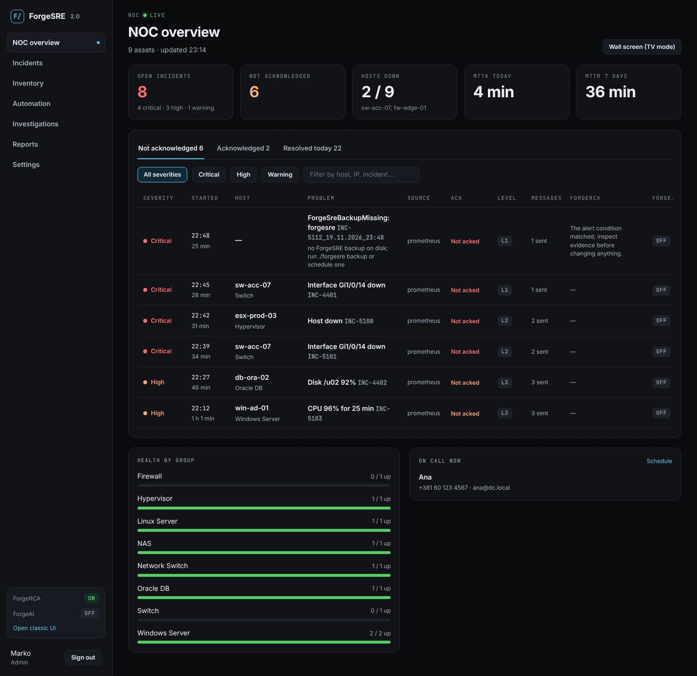
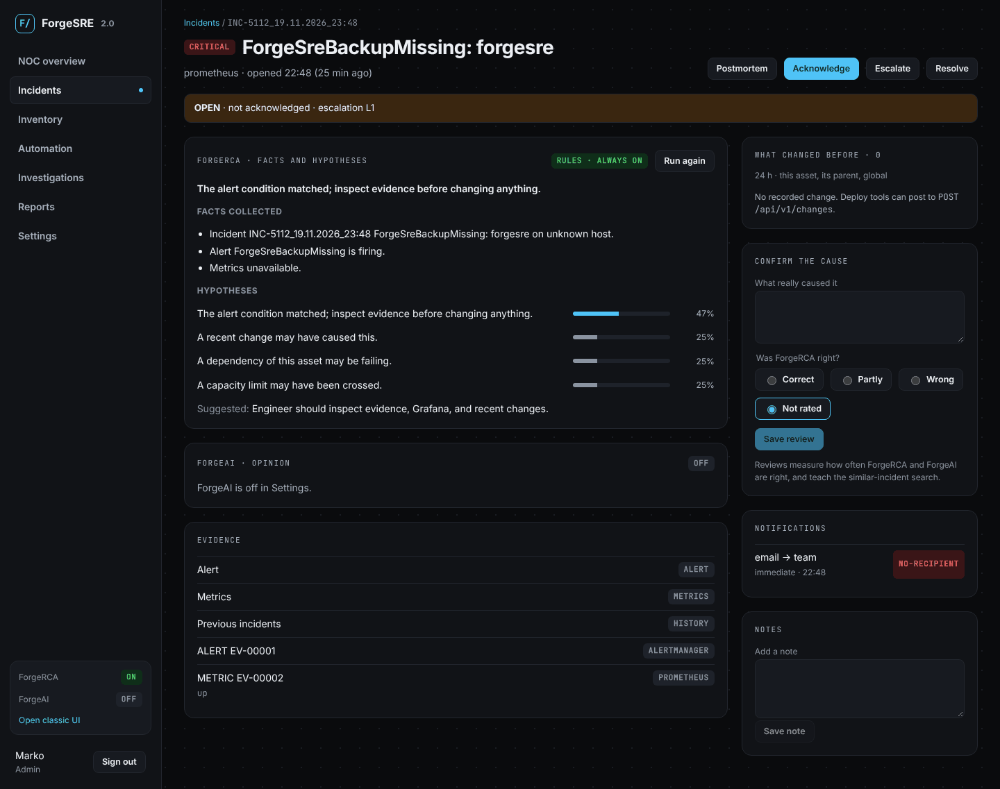

# ForgeSRE

**Self-hosted NOC and SRE console for physical data centers.** One Ubuntu VM, Docker Compose,
your data stays on your server.

ForgeSRE turns the alarms from Prometheus, Alertmanager and (optionally) Zabbix into incidents
that someone owns: a playbook checklist, an escalation ladder with mail to the right person,
quiet periods for maintenance and known noise, and a read-only investigation that says what
probably happened. An optional local LLM (ForgeAI) writes the summary; nothing is sent to a
cloud service unless you turn that on.

Current product: V2.0 · License: [Apache-2.0](LICENSE) · Code lives on [`main`](https://github.com/nsimic2022/forgesre).



New here? Read the [guide](docs/README.md#guide): six short chapters with screenshots.

---

## Why ForgeSRE

- **Built for on-prem.** Servers, switches, racks and sites in your own rooms, not only Kubernetes
  in someone else's cloud.
- **Your data stays home.** The UI loads nothing from the internet (fonts are bundled, no CDN).
  The LLM runs on the box by default; a cloud model is opt-in, per investigation, and secrets are
  stripped first.
- **Less noise, not more dashboards.** Noise filters, maintenance windows and playrules decide
  which alarm becomes an incident and which is expected (a 95 % disk during the nightly backup).
- **Explainable investigations.** ForgeRCA collects facts and hypotheses with plain Python rules,
  always first. ForgeAI only rewrites them into prose, so you can see why it says what it says.
- **Runs over SSH.** Everything the UI shows about health can be checked with `./forgesre`.

## What it does

| Area | What you get |
|---|---|
| **Monitoring** | Linux (`node_exporter :9100`), Windows (`windows_exporter :9182`), network devices over SNMP (bundled `snmp_exporter`), device syslog into Loki (Alloy on 514). Predictive disk alerts. |
| **Inventory** | One asset list with owners, sites, racks and types. Sources: manual entry, discovery, NetBox, LibreNMS, Zabbix and GLPI (read-only imports). |
| **Incidents** | Alertmanager opens `INC-…` incidents with an owner, severity, timeline and notes. Ack, assign, resolve. The list shows 10 per page with filters and search. |
| **Automation** | Playrules map an alert to a playbook and an escalation policy; noise filters and maintenance windows keep expected alarms quiet; a simulator shows what an alarm would do. |
| **On-call and escalation** | Weekly on-call slots, escalation steps by minutes and level, mail through your SMTP (Gmail, Outlook or on-box). |
| **Investigations** | ForgeRCA facts and hypotheses, ForgeAI summary, evidence from Prometheus and Loki, and a review step to rate the root cause. |
| **Reports** | Incident trends, noisiest assets, top alerts, downtime; CSV export and scheduled mail reports. |
| **Kubernetes** | Optional read-only cluster reader for Kubernetes, OpenShift and k3s: nodes and workloads in the inventory, basic alerts, deploys as changes; cluster Alertmanagers post to ForgeSRE ([docs/kubernetes.md](docs/kubernetes.md)) |
| **AI clients** | Optional read-only MCP server at `/mcp` for Claude, Cursor and others ([docs/mcp.md](docs/mcp.md)); off by default |
| **Operations** | System Health (`/health-ui`) and `./forgesre doctor`, a journal per module, background jobs, backup and restore. |

Four roles: Viewer, Analyst (NOC operator), Engineer (changes everything operational), Admin
(settings, integrations, users, backup). Permissions are checked on the server for every write.
Details: [handbook §3](docs/operator-handbook.md#3-roles-and-who-can-click-what).



---

## Quick start

You need an Ubuntu VM (4 GB RAM without the LLM, ~16 GB with it) with Docker, Docker Compose,
Bash and Git.

```bash
git clone https://github.com/nsimic2022/forgesre.git
cd forgesre
./install.sh --non-interactive --profile standard --port 8080
```

Sign in at `http://<VM-IP>:8080` with the credentials in `installation-report.md`, then change
the admin password. A demo host, `forge-demo-01`, is seeded so you can see a full incident in the
first hour:

```bash
./forgesre demo          # live HighCPU incident + mail to the asset owner
./forgesre demo-reset    # calm the demo host down again
./forgesre doctor        # health lights: the first command when something is wrong
```

`./install.sh` is for the first install only. On a running box:

```bash
git pull origin main
./forgesre update        # backup, render monitoring, images, compose up, doctor
./forgesre restart       # just bounce the running containers
```

Full Ubuntu / vCenter manual: [docs/install-config.md](docs/install-config.md).

### Optional local LLM

ForgeRCA works without a model. To add ForgeAI on the box (default Qwen2.5-14B-Instruct Q4_K_M,
~9 GB on disk, served by llama.cpp on `127.0.0.1:8088`):

```bash
./forgesre fetch-llm
```

Smaller models, offline copies and cloud models: [docs/llm.md](docs/llm.md).

### Network devices and integrations

- **SNMP:** add the device under Assets as *Network device* with its IP, then `./forgesre snmp`.
  Custom communities and SNMPv3 users: save the asset, then `./forgesre snmp-auths`.
  Details: [handbook §7](docs/operator-handbook.md#network-device-snmp_exporter).
- **Zabbix (read-only):** [docs/zabbix.md](docs/zabbix.md), summary in
  [handbook §18](docs/operator-handbook.md#18-zabbix-read-only-source).
- **GLPI (read-only):** [docs/glpi.md](docs/glpi.md).

---

## The interface

After sign-in you land in the new UI (React, served by Core at `/app`): NOC, Incidents,
On-call, Inventory, Automation, Investigations, Reports and Settings, each with its own
editing. The classic UI stays at `/classic`, and `ui.home: classic` makes it the home page
again. See [docs/ui.md](docs/ui.md).

| Page | What you do there |
|---|---|
| NOC (`/app`) | Active incidents, levels, what was sent, ForgeAI state |
| TV mode (`/app/tv`) | Wall screen: big numbers, a 12-hour incident clock, on call now, what is burning |
| Incidents | Active, open and resolved incidents with filters; one page per incident with checklist, timeline and investigation |
| Inventory | Assets library grouped by site, rack, type and owner; views for down, alarming and unowned |
| Automation | Noise filters, playrules, playbooks, escalation, maintenance, alarm simulator |
| Reports | Trends, CSV export, scheduled reports |
| Settings | IPs, ports, integrations and tokens (secrets are write-only), with a test button per integration |
| System Health | Doctor grid and journal (`/health-ui`) |

## CLI

`./forgesre help` lists every command (`./f` is the same CLI with a shorter name). A few you will
use daily:

```bash
./forgesre incidents           # open incidents; ./forgesre incidents INC-000012 for one
./forgesre journal             # module log
./forgesre jobs                # background jobs and queues
./forgesre settings            # view settings; settings set-secret for tokens
./forgesre verify              # exporter → Prometheus → Alertmanager → Core, per asset
./forgesre backup              # ./forgesre restore <dir> --yes to restore
```

All commands: [docs/cli.md](docs/cli.md).

## Architecture

One Core process (Python 3.12, FastAPI, SQLAlchemy) with PostgreSQL, next to Prometheus,
Alertmanager, snmp_exporter, Loki, Grafana Alloy and Grafana, all in Docker Compose on host
networking. Optional: llama.cpp, bundled NetBox and LibreNMS, an on-box mailbox. Slow work
(investigations, discovery, syncs, reports) runs as background jobs; only one Core worker runs
the background loops at a time. More: [docs/architecture.md](docs/architecture.md).

Configuration lives in `config/forgesre.yml` (behaviour), `.env` (ports and paths) and
`secrets/secrets.env` (passwords and tokens). The last two and `data/` are never committed.

---

## Roadmap

Next: editing everything in the new UI and making it the default, Slack / Teams / Discord
notifications, discovery through LibreNMS, one merged asset list from all sources, a second
generation of ForgeAI, a read-only MCP server and SLOs. See [docs/roadmap.md](docs/roadmap.md).

## Contributing

Issues and pull requests are welcome. Read [CONTRIBUTING.md](CONTRIBUTING.md) first, then
[AGENTS.md](AGENTS.md) for how code is written here. Please follow the
[Code of Conduct](CODE_OF_CONDUCT.md). Security problems go through a private report, not a
public issue: [SECURITY.md](SECURITY.md).

## Docs

[Docs index](docs/README.md) · [Operator handbook](docs/operator-handbook.md) ·
[Install and config](docs/install-config.md) · [CLI](docs/cli.md) · [Alerting](docs/alerting.md) ·
[Settings](docs/settings.md) · [LLM](docs/llm.md) · [MCP](docs/mcp.md) · [Architecture](docs/architecture.md)

## License

ForgeSRE is licensed under the [Apache License 2.0](LICENSE). "ForgeSRE" is the name of this
project; please do not use it for a fork or a derived product in a way that suggests it is the
original. See [NOTICE](NOTICE).
