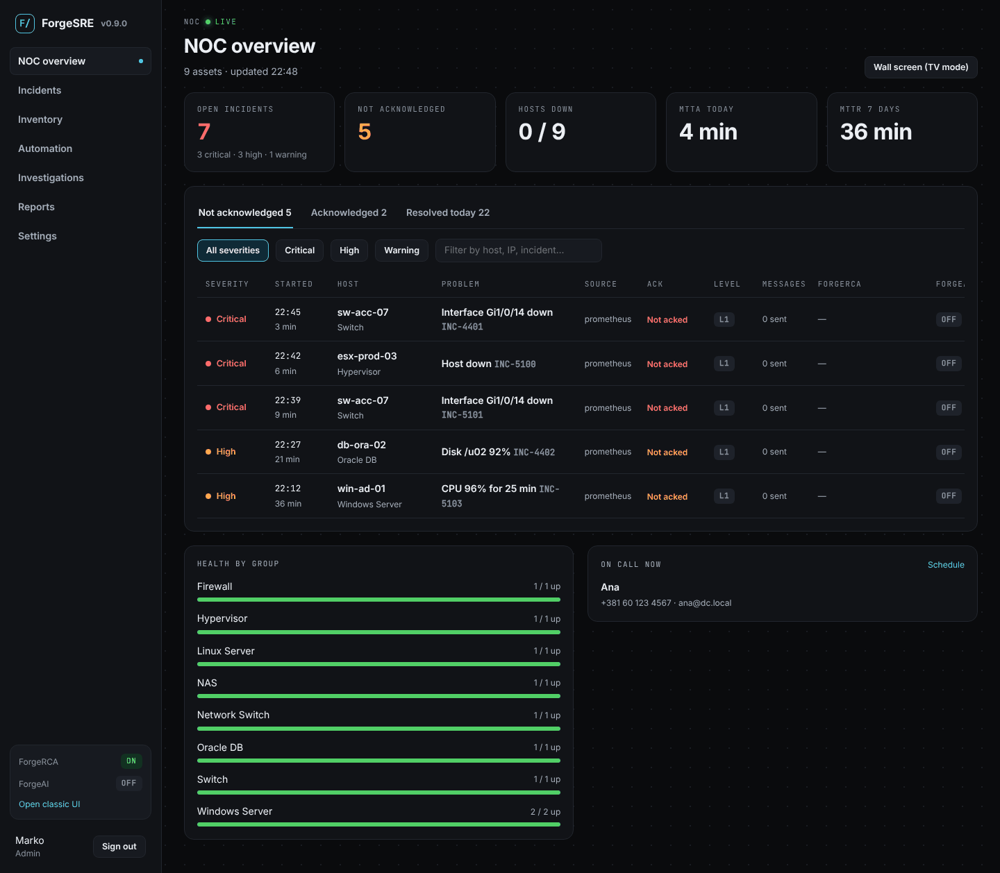

# 1. Getting started

ForgeSRE is one Ubuntu machine that watches your servers and network, opens an incident
when something breaks, tells the right person, and remembers what happened. Everything
runs on that machine: no cloud account and no data sent out unless you switch it on.

This chapter gets you from an empty VM to a signed-in browser in about twenty minutes.

## What you need

- Ubuntu with Docker: 4 CPU, 8 GB RAM, 40 GB disk (2 CPU / 4 GB / 10 GB is the minimum;
  about 16 GB RAM with the local AI model)
- Docker with Compose, Git, and SSH access to the VM
- Ports 8080 (ForgeSRE), 3000 (Grafana), 8001 (NetBox), 8000 (LibreNMS) and 514 (syslog)
  reachable from the operators' network

Details on sizing and VMware guests: [install-config.md](../install-config.md).

## Install

```bash
git clone https://github.com/nsimic2022/forgesre.git
cd forgesre
./install.sh
```

The installer asks a few questions (time zone, port, whether to scan your network) and
generates every password. When it is done it writes **`installation-report.md`** next to
the code: the addresses to open and where each password lives. Only root on the VM can
read it.

Want the local AI assistant too? Add `--profile full-ai` (downloads a 2.5 GB model), or later
run `./forgesre fetch-llm`. Everything else works without it.

## Check it is healthy

```bash
./forgesre doctor
```

One line per part of the platform, green, yellow or red, with the reason. This is always
the first command to run when something looks wrong. `./forgesre test` runs the longer
end-to-end report.

## Sign in

Open `http://<VM-IP>:8080`. The first account is the Admin from `installation-report.md`.
You land on the **NOC overview**: the page your team will look at all day.



Along the left: NOC, Incidents, Inventory, Automation, Investigations, Reports and
Settings. At the bottom, whether ForgeRCA (rule-based analysis, always on) and ForgeAI
(the optional language model) are running, and a link to the classic UI for the few pages
that still live there.

## See it work in two minutes

```bash
./forgesre demo
```

This raises a fake high-CPU alarm on a demo host. Within a minute an incident appears on
the NOC page, the owner gets an email (if mail is set up) and ForgeRCA adds its first
findings. `./forgesre demo-reset` calms it down again.

## Next

- Add your first servers and switches: [Assets and dependencies](03-assets.md)
- Invite the team and set up email: [Running the appliance](06-admin.md)
- Learn the daily routine: [A day on the NOC](02-daily-work.md)
