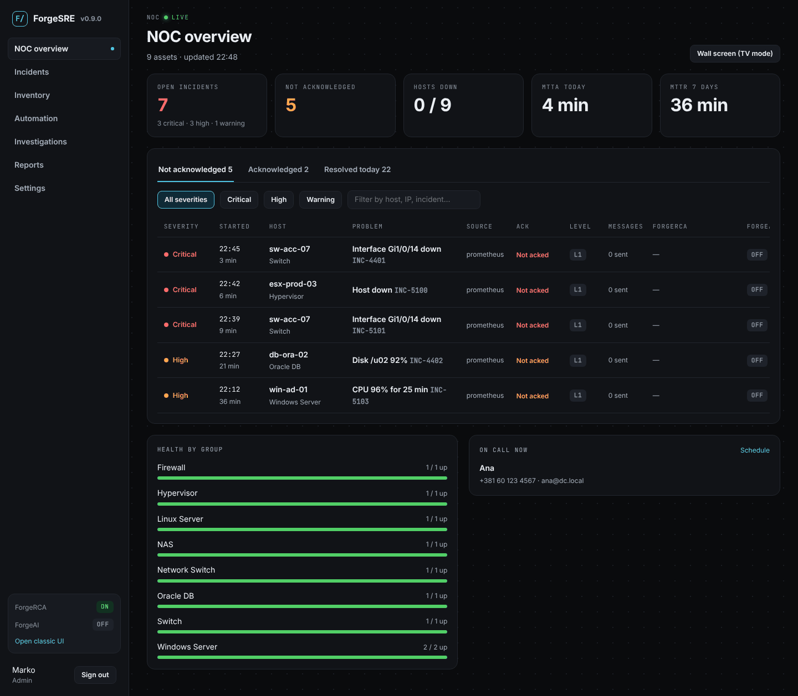
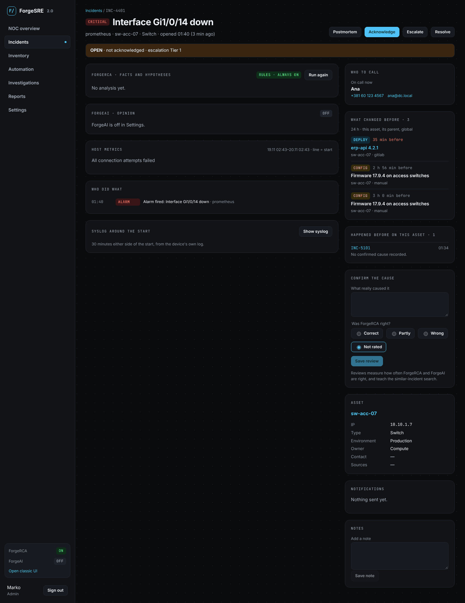
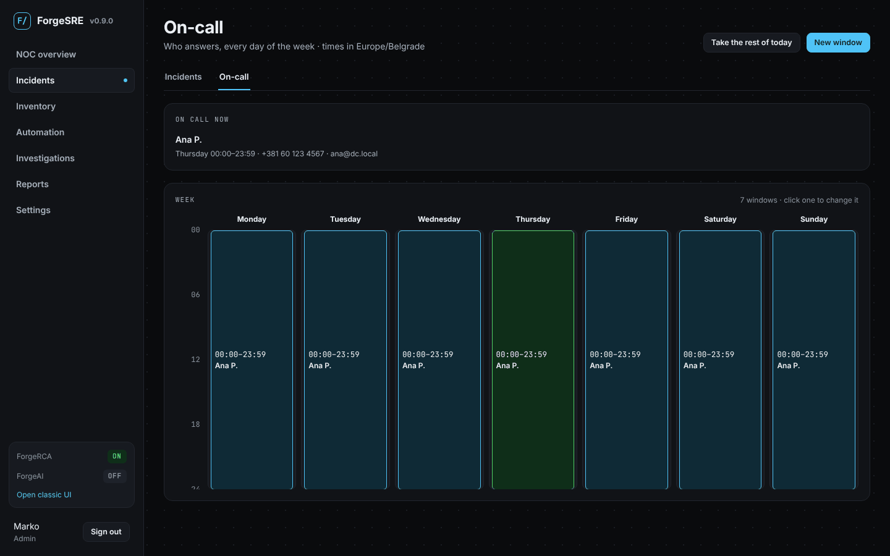
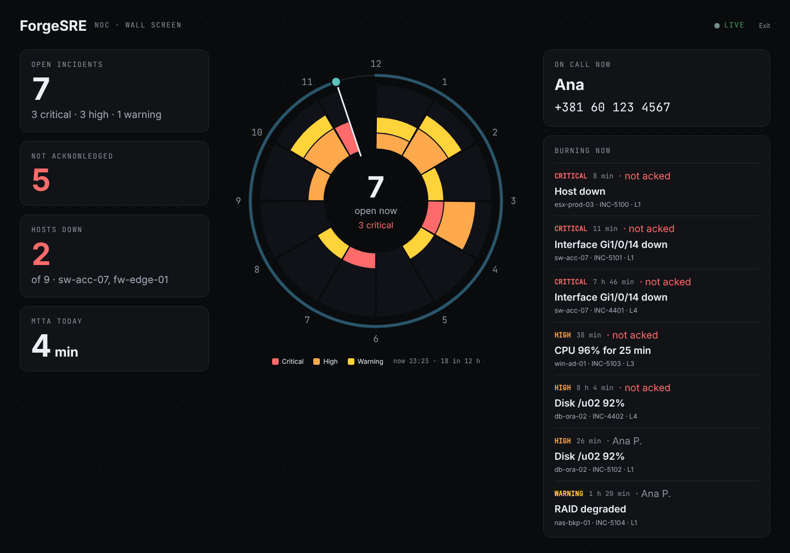

# 2. A day on the NOC

This is the routine for the people on shift: notice, acknowledge, fix, write down what
happened. Analysts can do all of it; Viewers can watch.

## The NOC overview



The five numbers at the top answer "how bad is it right now": open incidents, how many
nobody has taken yet, hosts down, and how fast the team reacts (MTTA today, MTTR over seven
days).

Below them, the incidents nobody has acknowledged, newest first. Switch tabs for the ones
already taken or resolved today, filter by severity, or type a host name or IP. **Tier**
shows how far escalation has gone (Tier 1 is the NOC, Tier 2 the shift lead, Tier 3 the
engineer, then the manager); **Messages**
shows how many notifications were sent.

At the bottom: health per asset group and who is on call now.

## Taking an incident

Click a row to open it.



1. **Acknowledge.** This tells everyone "I have it" and stops escalation. If you got the
   alarm by email, the link in the mail opens a page with an **Acknowledge** button that
   works without signing in (it needs `system.public_url` set in Settings).
2. **Look at what changed.** The *What changed before* card lists deploys, config pushes,
   tickets and edits made in ForgeSRE in the 24 hours before the alarm, on this asset or
   the one it hangs from. Most outages start with a change; this card is usually the
   fastest clue.
3. **Read ForgeRCA.** It collects facts (metrics, logs, similar past incidents) and offers
   hypotheses. It never touches the system; it only reads.
4. **Follow the playbook**, if the alarm has one: tick the steps as you go so the next
   person sees where you are.
5. **Write notes** as you work. They end up in the timeline and the postmortem.
6. **Resolve** when it is fixed, then fill *Confirm the cause*: what really caused it, and
   whether ForgeRCA was right. These reviews make the similar-incident search better.

Need help? **Escalate** moves it to the next level now instead of waiting.

## The incident list


All incidents, open and closed, with search and filters. Ten per page; use it to find
"didn't this happen last month too?".

## Postmortem

For anything worth a review meeting, press **Postmortem** on the incident. ForgeSRE writes
a Markdown draft from what it knows: timeline, impact (what sits behind the asset), what
changed, notes, the confirmed cause, the playbook. It invents nothing: every gap is marked
`[to fill]`. Copy it or download the `.md` and paste it into your wiki.

## On call



Open it with **Schedule** on the NOC page's *On call now* card. It shows who is on call now
and next; an Engineer adds, edits or copies windows here. Escalation calls this person first.

## The wall screen



**Wall screen (TV mode)** on the NOC page opens a page made for a screen on the wall: large
numbers, who is on call, open incidents, and the **incident clock** in the middle.

The clock shows the last twelve hours on a normal clock face. Each hour's incidents sit
where that hour is on a real clock, critical on the inside, then high, then warning. The
hand and the dot on the rim mark the time now. A quiet night is a nearly empty dial; a bad
hour is easy to spot from across the room.

If the page stops getting updates for 90 seconds it shows a red **No updates** banner, so an
old picture never passes for a calm night. Sign the wall computer in with a Viewer account.

## From the shell

Everything above can be checked over SSH too:

```bash
./forgesre incidents             # colored board of open incidents
./forgesre incidents INC-5100    # one incident with notes and mails
./forgesre history --days 30     # what happened lately
```
