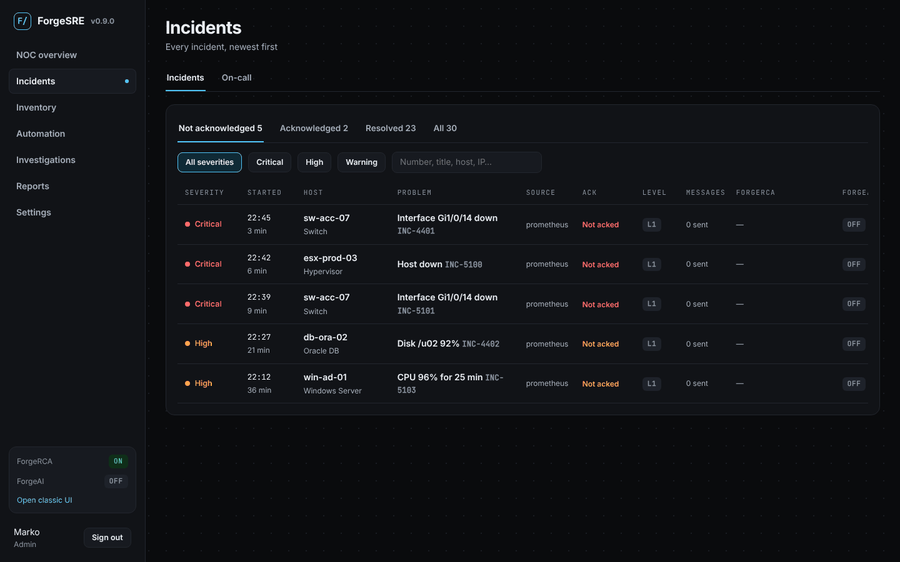

# 2. A day on the NOC

This is the routine for the people on shift: notice, acknowledge, fix, write down what
happened. Analysts can do all of it; Viewers can watch.

## The NOC overview


The five numbers at the top answer "how bad is it right now": open incidents, how many
nobody has taken yet, hosts down, and how fast the team reacts (MTTA today, MTTR over seven
days).

Below them, the incidents nobody has acknowledged, newest first. Switch tabs for the ones
already taken or resolved today, filter by severity, or type a host name or IP. **Tier**
shows how far escalation has gone (Tier 1 is the NOC, Tier 2 the shift lead, Tier 3 the
engineer, then the manager); **Messages**
shows how many notifications were sent.

Above the list, one line says who is on call now and whether the last shift handover was taken
over; *Shift and schedule →* opens Incidents › On-call. Hosts that do not answer are counted in
*Hosts down* at the top (Inventory › *Down now* lists them).

## Taking an incident

Click a row to open it.


1. **Acknowledge.** This tells everyone "I have it" and stops escalation. If you got the
   alarm by email, the link in the mail opens a page with an **Acknowledge** button that
   works without signing in (it needs `system.public_url` set in Settings).
2. **Look at what changed.** The *What changed before* card lists deploys, config pushes,
   tickets and edits made in ForgeSRE in the 24 hours before the alarm, on this asset or
   the one it hangs from. Most outages start with a change; this card is usually the
   fastest clue.
3. **Read ForgeRCA.** It collects facts (metrics, logs, similar past incidents), offers
   hypotheses and **what to do next**, and says what it could not check. It never touches the
   system; it only reads.
   **ForgeAI** (when it is on) then asks the local model once, with the skill that fits the
   alarm, for the likely cause, the first three checks and a line for the shift lead. Answers
   that contain a number, IP or command not in the facts are thrown away. **Explain for Tier 1**
   and **Incident review summary** ask for more; **What was ForgeAI asked?** shows the exact prompt
   and the model's answer word for word. 👍 / 👎 tells the team which skills work.
   **Investigate with tools** goes further (1–4 minutes): ForgeAI may look at a metric, the
   host's logs, the device's interfaces and similar incidents, then gives the cause with a
   confidence and the numbered evidence it rests on. An answer that cites evidence it was never
   shown is thrown away.
   Next to it: **Host metrics** from an hour before the alarm to now (the grey line is the
   start), **Happened before on this asset** with the cause that was confirmed last time, and
   **Syslog around the start** from the device's own log.
4. **Follow the playbook**, if the alarm has one: tick the steps as you go so the next
   person sees where you are.
5. **Write notes** as you work. They end up in the timeline and the incident review.
6. **Resolve** when it is fixed, then fill *Confirm the cause*: what really caused it, and
   whether ForgeRCA was right. These reviews make the similar-incident search better.

Need help? **Who to call** lists the on-call person, the asset's contact and backup (phone
numbers are links) and the vendor's support line. **Escalate** moves it to the next tier now
instead of waiting.

**Who did what** tells the whole story in order: the alarm, every mail and chat message (and
whether it was delivered), the acknowledgement, notes, playbook steps and the resolve.

## The incident list



All incidents, open and closed, with search, severity and a **From / To** day range. Ten
per page; use it to find "didn't this happen last month too?". **Export CSV** downloads the
list with the same filters (UTF-8, opens in Excel with the right letters).

## Incident review

For anything worth a review meeting, press **Incident review** on the incident. ForgeSRE writes
a Markdown draft from what it knows: timeline, impact (what sits behind the asset), what
changed, notes, the confirmed cause, the playbook. It invents nothing: every gap is marked
`[to fill]`. Copy it or download the `.md` and paste it into your wiki.

## Send report

**Send report** on the incident mails the report to whoever needs it: the asset owner, a
manager, a supplier. Pick from the suggested addresses or type them (up to 10), change the text
if you like, and press **Send**. Each address shows sent or failed with the reason; every mail
is also in the Outbox on the Reports page.

## On call


Open it with **Shift and schedule →** in the shift line on the NOC page. It shows who is on call now
and next; an Engineer adds, edits or copies windows here. Escalation calls this person first.

## Shift handover

The **Shift** card at the top of Incidents › On-call holds the change of shift in one place: who is
on call now, the handover (*Write handover*, and the next person's *I take over*) and, with
ForgeAI on, *Draft with ForgeAI*: a summary of the last 12 hours (what happened, what is still
open, what to keep an eye on) that *Use as handover notes* copies into the handover to check and
send. The NOC page shows one line with who is on call and whether the handover was taken over.

## The wall screen


**Wall screen (TV mode)** on the NOC page opens a page made for a screen on the wall: large
numbers, who is on call, open incidents, and the **incident clock** in the middle.

The clock shows the last twelve hours on a normal clock face. Each hour's incidents sit
where that hour is on a real clock, critical on the inside, then high, then warning. The
hand and the dot on the rim mark the time now. A quiet night is a nearly empty dial; a bad
hour is easy to spot from across the room.

If the page stops getting updates for 90 seconds it shows a red **No updates** banner, so an
old picture never passes for a calm night. Sign the wall computer in with a Viewer account.

## From the shell

Everything above can be checked over SSH too:

```bash
./forgesre incidents             # colored board of open incidents
./forgesre incidents INC-5100    # one incident with notes and mails
./forgesre history --days 30     # what happened lately
```
