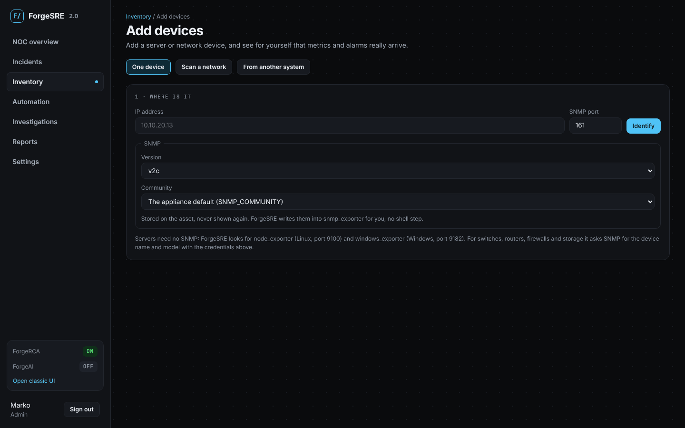

# 3. Assets and dependencies

An **asset** is anything ForgeSRE watches: a server, a switch, a firewall, a database, a
Kubernetes cluster. Each one knows its type, owner, contact and the asset it depends on.
Good asset data is what makes the right person get the right mail. Changes here need an
Engineer.

## Inventory

**Inventory › Add devices** is the way in. It does not stop at "saved": it shows you that
metrics and alarms really arrive.

**One device**

1. Enter the IP. For switches, routers, firewalls and storage, give the SNMP credentials:
   v2c with the appliance default community or the device's own, or a v3 user with its
   passwords. Servers need none.
2. **Identify** asks the address in the background: which ports answer, whether
   node_exporter (Linux, 9100) or windows_exporter (Windows, 9182) gives metrics, and over SNMP
   the device's name, model and location. You get a suggested host name and type, and a line
   saying how ForgeSRE will watch it.
3. Check the name, type, owner and contact, then **Add and start monitoring**. ForgeSRE tells
   Prometheus about the new target (it asks every 30 seconds) and, for a device with its own
   community or a v3 user, writes the credentials into snmp_exporter and reloads it. There is
   no shell step any more.
4. **Is it really monitored?** runs the live chain and shows each step: the address answers,
   the exporter or SNMP answers, the right metrics come back, Prometheus has the target and
   scrapes it (up = 1), samples are stored, Alertmanager is up, alarms reach ForgeSRE. A red
   step says what to fix. **Check again** after a minute.

Every asset card has the same **Check monitoring** button, so you can prove any asset is
watched, whichever way it got into the inventory.

**Scan a network** probes up to 256 addresses per range (TCP 22, 80, 443, 9100, 9182, 10050,
12345 and SNMP with the default community) in the background and lists what answered.
Nothing becomes an asset until you press **Add**; then the monitoring check runs for it.

**From another system**: NetBox, Zabbix, GLPI and LibreNMS are read every 6 hours when turned
on, or now with **Sync now** on their card in Settings › Integrations. ForgeSRE never writes
back to them.

**By hand**: **New asset by hand** opens the full form, SNMP credentials included.

**From a CSV file**: **Import CSV** reads one asset per line; the first line names the columns
(`hostname` is required; `ip`, `type`, `environment`, `owner`, contact fields, `site`, `row`,
`rack`, `customer`, `parent` and the other card fields are optional; comma or semicolon). **Check
file** shows each line as Add, Already there or Problem with the reason, and writes nothing.
**Add** then creates the accepted lines in the background. Assets already in the inventory
(same id or IP) are skipped, never changed. SNMP communities and passwords are not read from a
file; set them on the asset afterwards. **Download a template** gives every column.

**Capacity**: the asset card shows the last 30 days of disk use and interface receive. When disk
use keeps climbing it says **~N days to full** (red at 30 days or less). ForgeSRE reads it from
Prometheus, or from Zabbix trends when Prometheus has no disk series, in the background and
keeps it 15 minutes. From the shell: `./forgesre capacity <host>`.

From the shell: `./forgesre ping <host>` checks that an address answers and exports metrics,
`./forgesre verify <host>` runs the same live chain, and `./forgesre snmp-auths` writes SNMP
credentials now instead of waiting for ForgeSRE (it does so within 5 minutes on its own).

## Dependency map

Every asset can have a **parent**: the switch a server is plugged into, the hypervisor a VM
runs on. When a parent goes down, alarms from everything behind it stay quiet, so one dead
switch gives one incident instead of forty.

- **Sync from LibreNMS** reads LLDP/CDP neighbours and suggests parents where the answer is
  clear (a server or AP behind a switch). Switch-to-switch links are not guessed. Accept one
  suggestion or all of them.
- The tree shows the biggest branches first, red where an alarm is open, and how many
  assets hang behind each one. **Change parent** refuses loops.

The incident page and the postmortem use this map to show impact.

## Maintenance windows

Planned work should not page anyone. In **Automation › Maintenance windows** pick one or more assets
and a time range. Alarms during the window still open incidents, but nobody is notified and
SLOs are not charged. **End now** closes a window early.

## Kubernetes, OpenShift, k3s

A cluster is added as an asset with an API address and a read-only token. ForgeSRE reads
nodes and workloads every five minutes and opens incidents for not-ready nodes and
crash-looping pods. Setup and the exact permissions: [kubernetes.md](../kubernetes.md).
