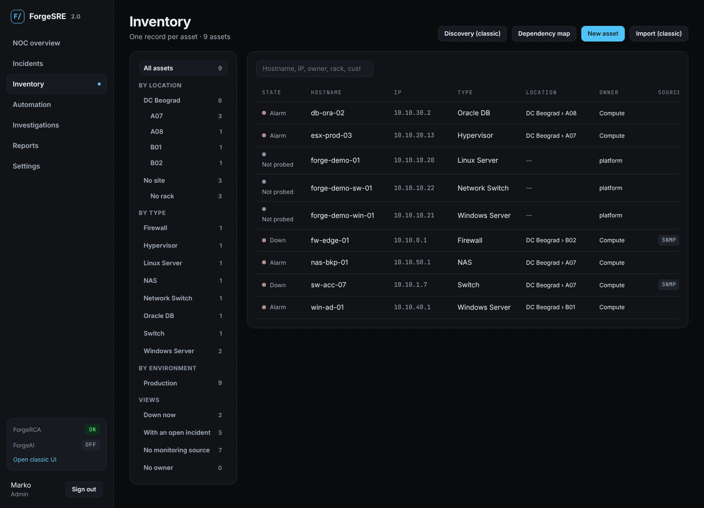
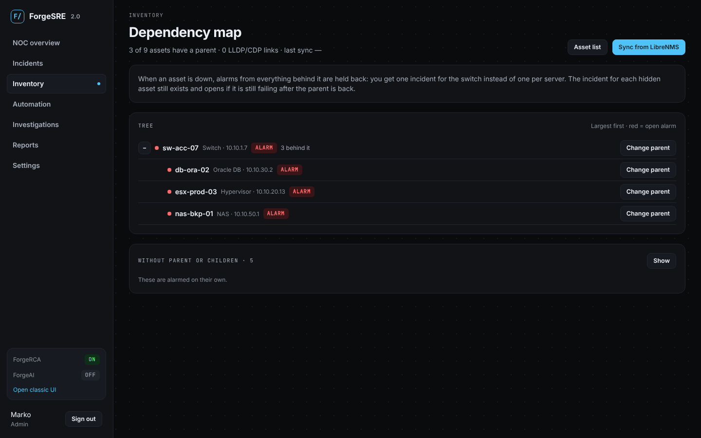

# 3. Assets and dependencies

An **asset** is anything ForgeSRE watches: a server, a switch, a firewall, a database, a
Kubernetes cluster. Each one knows its type, owner, contact and the asset it depends on.
Good asset data is what makes the right person get the right mail. Changes here need an
Engineer.

## Inventory

Three ways to fill it:

- **By hand**: **New asset**, enter host name and IP, pick a type. Edit any row in place.
- **Discovery**: ForgeSRE scans the networks you allowed (Settings › Discovery) and offers
  what it finds. In the default *manual* mode you confirm each one; *semi-automatic* and
  *automatic* add more on their own.
- **Sync**: from NetBox (bundled or your own), LibreNMS, GLPI or Zabbix. These are read-only:
  ForgeSRE never writes back to them.

Linux and Windows servers report through node_exporter / windows_exporter; network devices
through SNMP. `./forgesre ping <host>` checks that a new asset answers and exports metrics;
`./forgesre verify <host>` follows the whole path from exporter to incident.

## Dependency map

Every asset can have a **parent**: the switch a server is plugged into, the hypervisor a VM
runs on. When a parent goes down, alarms from everything behind it stay quiet, so one dead
switch gives one incident instead of forty.

- **Sync from LibreNMS** reads LLDP/CDP neighbours and suggests parents where the answer is
  clear (a server or AP behind a switch). Switch-to-switch links are not guessed. Accept one
  suggestion or all of them.
- The tree shows the biggest branches first, red where an alarm is open, and how many
  assets hang behind each one. **Change parent** refuses loops.

The incident page and the postmortem use this map to show impact.

## Maintenance windows

Planned work should not page anyone. In **Automation › Maintenance windows** pick one or more assets
and a time range. Alarms during the window still open incidents, but nobody is notified and
SLOs are not charged. **End now** closes a window early.

## Kubernetes, OpenShift, k3s

A cluster is added as an asset with an API address and a read-only token. ForgeSRE reads
nodes and workloads every five minutes and opens incidents for not-ready nodes and
crash-looping pods. Setup and the exact permissions: [kubernetes.md](../kubernetes.md).
