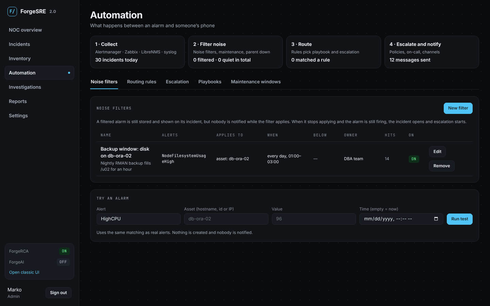
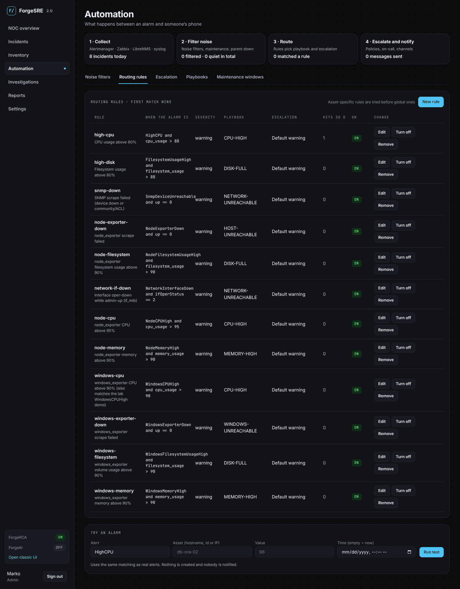
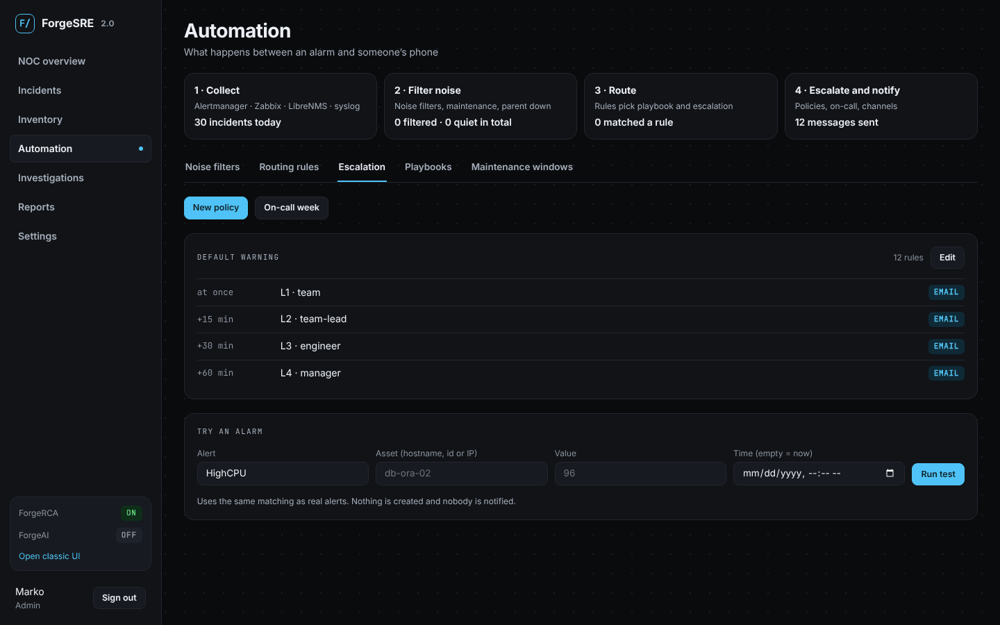
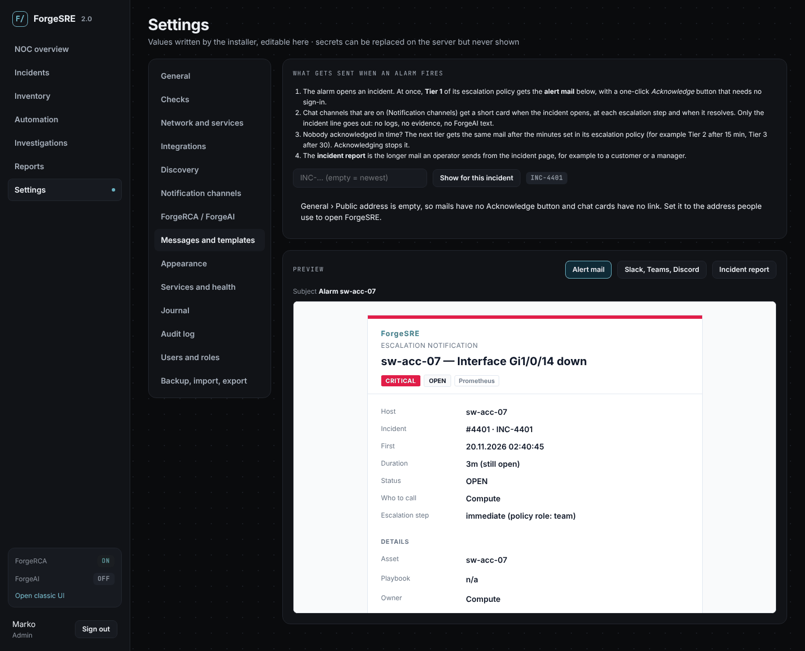

# 4. Alarms, noise and escalation

Every alarm takes the same short path. Knowing it is how you make ForgeSRE call people
only when it matters.

```
alarm (Prometheus, Zabbix, a check)
  → noise filter?        record quietly, or wait N minutes
  → maintenance?         open, but notify nobody
  → parent down?         open, but notify nobody
  → routing rule         severity, playbook, escalation policy
  → incident             notify Tier 1, 2, 3, then the manager, until someone acknowledges
```

All of it lives under **Automation** and needs an Engineer to change. The exact rules
and the runbook format are in [alerting.md](../alerting.md).

## Noise filters



A noise filter catches alarms you know are not worth a person's time: a flapping test
port, a nightly backup that always spikes the CPU. Match by alarm name, asset or group,
days and hours, and a maximum value. Then choose: **record, notify nobody**, or **wait
before opening** (the alarm only becomes an incident if it lasts longer than N minutes).
Give it an owner and an expiry date so it does not outlive its reason. Each filter shows
how often it matched.

## Routing rules



A rule says: for this alarm (optionally above this value), use this severity, this
playbook and this escalation policy. Asset-specific rules win over global ones. With no
matching rule the incident still opens, just without a playbook.

**Try an alarm** sends a pretend alarm through the whole path and shows what would happen,
without opening anything. Use it before saving a new rule.

## Escalation



A policy has up to four steps: Tier 1 (NOC), Tier 2 (shift lead), Tier 3 (engineer) and the
manager, the usual support-tier model. Each says who to tell (on-call, a team, a person), how
(email, chat) and after how many minutes without an acknowledgement. Acknowledging stops
it; **Escalate** on the incident jumps a level now.

The *default-warning* policy cannot be removed; rules from a deleted policy fall back to it.

## What people receive



**Settings › Messages** shows, for any incident, exactly what goes out: the
alert mail (subject, the one-click **Acknowledge** button, the asset's owner, contact and
phone), the Slack, Teams and Discord card for *opened*, *escalated* and *resolved*, and the
longer incident report an operator can mail from the incident page. Nothing is sent from
there. Set **General › Public address** first: without it mails have no Acknowledge button
and chat cards have no link.

## Chat notifications

Slack, Microsoft Teams and Discord get a card for each incident event: a colour bar for the
severity (green when resolved), host, incident number, severity, start time and an
**Open incident** button.
Turn them on in Settings › Notifications and store the webhook with
`./forgesre settings set-secret`. Messages are sent in the background, so a slow chat
service never delays an alarm. Only the incident line leaves the server.

## ForgeAI skills

When ForgeAI is on, it is asked once per incident for the likely cause and the first checks.
**Automation › ForgeAI skills** decides what it is told for each kind of alarm: a skill for disks,
one for network links, one for databases and so on, each with plain-language instructions you can
change, try on a real incident before saving, and roll back. The safety rules (use only the facts,
no commands, no invented numbers) are added by ForgeSRE and cannot be edited away. Investigations
shows which skills operators found useful. Details: [llm.md](../llm.md).

**Tuning**, under each skill, puts its answers next to what the analysts confirmed on the
incident review card, worst-rated first, with why answers were rejected. Change the
instructions, then **Replay** asks the model again on the last ten resolved incidents with a
confirmed cause and shows the old and new answer side by side. Replays are trials: nothing on the
incidents changes. Over SSH: `./forgesre forgeai tuning`.

## Checks ForgeSRE runs itself

Some problems never raise a metric. Every 15 minutes ForgeSRE checks:

- **TLS certificates** you listed: warning 14 days before expiry, critical at 3
- **Backup age**: the newest ForgeSRE backup is older than 36 hours
- **Heartbeats**: a cron job or script that should call in every N minutes went silent

See them with `./forgesre checks`. Setup: [alerting.md](../alerting.md).
