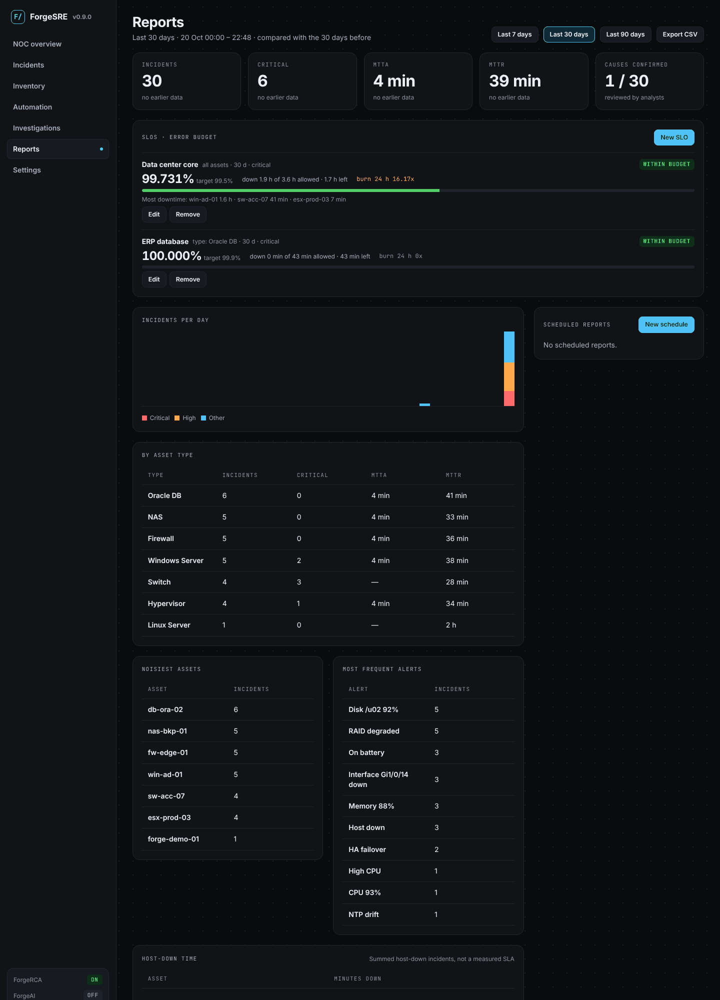
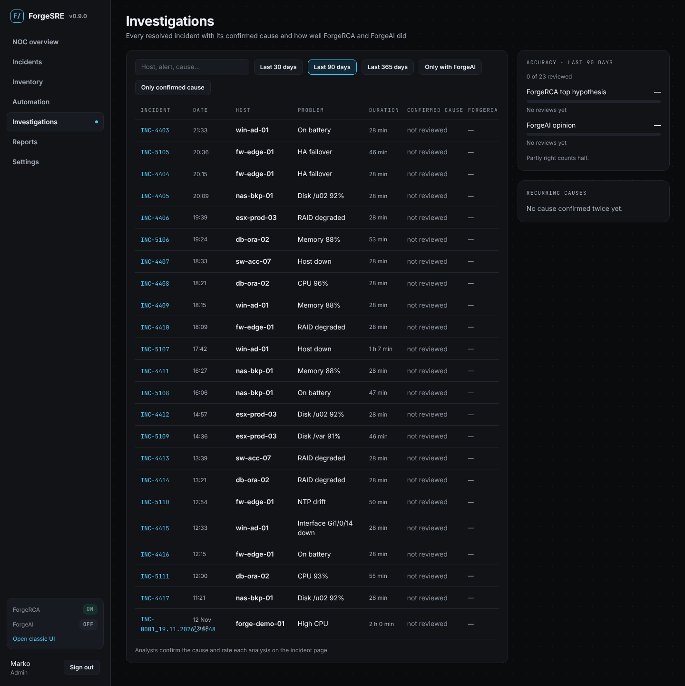

# 5. Reports and SLOs

Reports answer the questions management asks: how often, how long, which systems, and
are we getting better. Everyone can read them; an Engineer can change SLOs and scheduled
reports.



## Reports

Pick a period and see the key numbers against the period before (incidents, time to
acknowledge and to resolve), incidents per day, by asset type, the noisiest assets, the
most frequent alerts and host-down time. **Export CSV** gives the raw list.
**New schedule** mails a report to a list of people, for example every Monday at 08:00.

Scheduled reports are sent **automatically** when they are due; nobody has to press anything.
The mail looks back one schedule interval (a day, a week or a month) and opens with the period
at a glance (incidents against the period before, time to acknowledge and resolve), incidents
per day, what is still open, the most frequent alerts and the noisiest assets. Then each asset
(the ones picked, or all) with its current metrics. **Preview** shows the mail with today's
data; **Send now** mails it once in the background without moving the schedule.

## SLOs and error budget

An SLO is a promise such as "99.9 % available over 30 days" for one asset, an asset type,
a site, or everything. ForgeSRE works it out from incident history:

- **Availability**: the share of the window without an open incident of the chosen
  severity. For a group, overlapping outages count once.
- **Error budget**: how much downtime the promise allows (99.9 % of 30 days is 43
  minutes), how much is used and how much is left. Over 75 % used is *at risk*; 100 % is
  *spent*.
- **Burn 24 h**: how fast the last day used the budget. Above 1.0x the budget runs out
  before the window ends.

Maintenance windows and filtered noise do not count against the budget. Changing an SLO
recalculates it from history right away.

```bash
./forgesre slo
```

## Investigations



How often ForgeRCA and ForgeAI were right, from the reviews operators fill in when they
resolve an incident, and the causes that keep coming back. A quick way to see whether the
suggestions can be trusted, and what to fix for good.
