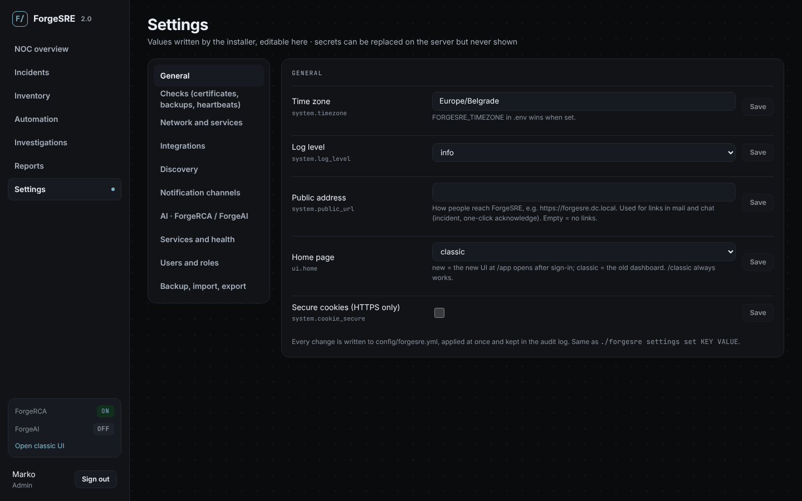

# 6. Running the appliance

For Admins: users, settings, backups, updates, and what to do when something is wrong.
Everything here can be done over SSH alone.

## Users and roles

| Role | Can |
|---|---|
| Viewer | Look at everything: NOC, incidents, inventory, reports. For wall screens and management |
| Analyst | Work incidents: acknowledge, assign, notes, playbook, local ForgeAI |
| Engineer | Change operations: inventory, rules, filters, playbooks, escalation, on-call, reports |
| Admin | Also settings, integrations, users, backup, import and export |

Each role has everything the one above it has. The last active Admin cannot be removed or
demoted, so you cannot lock yourself out.

## Settings



One card per area: mail, chat, discovery, integrations (NetBox, LibreNMS, GLPI, Zabbix,
Kubernetes), ForgeAI, retention. Each card has **Test**; a failing integration shows its
error on its card and in the journal, but never stops alarms coming in.

The same from the shell:

```bash
./forgesre settings list
./forgesre settings set notifications.email.host mail.example.com
./forgesre settings test
./forgesre settings set-secret SMTP_PASSWORD      # asks for the value, never prints it
```

Passwords and tokens are write-only: neither the UI nor the CLI ever shows them again.

## Backups

```bash
./forgesre backup              # database, config and secrets into data/backups/<date>
./forgesre restore             # list backups, newest first, pick a number
./forgesre restore 1 --yes      # apply the newest one
```

Add `--no-secrets` for a copy you can hand to someone else. Copy `data/backups` off the
machine regularly; ForgeSRE opens an incident when the newest backup is older than 36
hours.

## Updates

```bash
git pull
./forgesre update
```

`update` takes a backup first, adds any new settings or secrets, refreshes the containers,
restarts and runs `doctor`. `./forgesre restart` only restarts what is running.

## When something is wrong

1. `./forgesre doctor`: one line per component with the reason.
2. `./forgesre logs core` (or another service name).
3. `./forgesre journal`: errors from integrations and background jobs.
4. `./forgesre test`: the full end-to-end report.

All commands: [cli.md](../cli.md). Common failures: [install-config.md](../install-config.md#16-troubleshooting).

## What leaves the server

By default, nothing. The UI loads no outside scripts or fonts, the AI model runs on the box,
and integrations only read. You choose what goes out:

- **Email and chat** notifications, to the addresses and webhooks you configure
- **A cloud model** for ForgeAI, if an Engineer re-runs an analysis with one
- **The MCP server**, which lets an AI client such as Claude Desktop read incidents and
  assets. Off until you enable it, read-only, and protected by a token: [mcp.md](../mcp.md)

## HTTPS

`./forgesre tls` shows how to put Caddy with a certificate in front of ForgeSRE.
