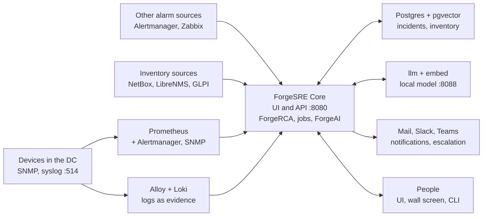

# ForgeSRE 2.0 — install, integration and ForgeAI guide

As of 24 November 2026. Serbian version: [vodic-sr.md](vodic-sr.md).

ForgeSRE is a NOC monitoring platform for watching data-center infrastructure. This guide covers
the install, what goes into `.env`, `secrets/secrets.env` and `config/forgesre.yml`, how to connect
other systems, and how to set up ForgeAI (the local and the optional cloud language model).

## 1. What ForgeSRE runs

ForgeSRE is one Docker Compose stack on one Ubuntu VM. Every service uses `network_mode: host`
and listens on `127.0.0.1`, except ForgeSRE Core (UI and API), Grafana, NetBox, LibreNMS and the
optional mail server. Only what people and devices need is reachable from outside.



Alarms and logs come in on the left; Core joins them with the inventory and keeps them in
Postgres; people get incidents, notifications and ForgeAI on the right.

| Service | Port | Profile | What it does |
| --- | --- | --- | --- |
| `core` | 8080 (`FORGESRE_HTTP_PORT`) | always | UI at `/app`, API, alarm intake, ForgeRCA, background jobs |
| `postgres` | 5432 (local only) | always | ForgeSRE database: incidents, inventory, users, settings, ForgeAI calls; pgvector for document search |
| `prometheus` | 9090 (local) | always | Metrics and alert rules |
| `alertmanager` | 9093 (local) | always | Sends alarms to Core through a webhook |
| `snmp-exporter` | 9116 (local) | always | SNMP metrics of network devices for Prometheus |
| `blackbox-exporter` | 9115 (local) | always | Synthetic checks: HTTP, TCP, DNS and ping probes (Settings › Checks) |
| `proxy` | 443 | profile `https` (new installs: on) | Caddy: HTTPS in front of the UI and API, certificate in `data/tls` |
| `loki` | 3100 (local) | always | Logs (syslog) as evidence for RCA |
| `alloy` | 514 syslog, 12345 (local) | always | Receives syslog and ships it to Loki |
| `grafana` | 3000 (`GRAFANA_PORT`) | always | Graphs, linked from System Health |
| `netbox` + `netbox-redis` + `netbox-db-init` | 8001 (`NETBOX_PORT`) | profile `netbox` (default on) | Inventory source (read, never written) |
| `librenms` + `librenms-db` + `librenms-redis` + `librenms-dispatcher` | 8000 | profile `librenms` (default on) | Device discovery (SNMP identify, ports, links) |
| `llm` | 8088 (local) | `ai` | llama.cpp with the local model (ForgeAI) |
| `llm-gpu` | 8088 (local) | `ai-gpu` (instead of `ai`) | Same, CUDA build on an NVIDIA GPU (`./forgesre gpu on`) |
| `embed` | 8089 (local) | `ai` or `ai-gpu` | Small embedding model (search in uploaded manuals) |
| `worker` | — | `worker` | Optional: background loops in their own process |
| `mailserver`, `roundcube`, `mailbox` | 25, 587, 993, 8081 | `mailbox` | Optional: own mail server |

Everything that must survive a restart lives in `FORGESRE_DATA` (default `./data`): Postgres,
models (`data/models/`), generated config (`data/generated/`), backups (`data/backups/`) and logs.
Settings live in three places, each with its own job: `.env` (ports, paths, profiles),
`secrets/secrets.env` (passwords and tokens) and `config/forgesre.yml` (platform behaviour, mostly
changed from Settings in the UI).

## 2. Before you install

Without the local model, 4 vCPU and 8 GB RAM are enough; with it, plan for 8 vCPU and 16 GB. No
GPU is needed: the model runs on the CPU.

**Our appliance VMs (16 vCPU, 32 GB RAM):** use Qwen3 8B (`./forgesre fetch-llm --model qwen3-8b`)
with `FORGESRE_LLM_THREADS=14`. It answers in about 1–2 minutes and gives clearly better causes than
4B, and leaves 20 GB for the platform. The 14B model also fits, but an answer takes several minutes;
use it only with a GPU. Run the golden set before and after switching models.

| Resource | No ForgeAI | Qwen3 4B | 8B model | 14B model |
| --- | --- | --- | --- | --- |
| vCPU | 4 (min. 2) | 8 | 8–12 | 12+ |
| RAM | 8 GB (min. 4) | 12–16 GB | 16 GB | 24 GB |
| Disk | 40 GB | + 3 GB | + 5 GB | + 9 GB |
| One answer | — | 30–90 s | 1–3 min | several minutes |

Prepare:

- Ubuntu Server 22.04 or 24.04, a static IP on the management network, correct time (NTP).
- Internet on the first install (GitHub, container registries, Hugging Face for the model).
  Without internet: `./install.sh --offline` and the model copied in by hand (section 8).
- Open ports to the VM: 8080 (UI), 514/udp and tcp (syslog from devices), 161/udp from the VM to
  devices (SNMP), optionally 3000, 8000 and 8001.
- Addresses and tokens of the systems you connect: Zabbix, GLPI, external NetBox, SMTP server,
  Slack/Teams/Discord webhook, Kubernetes clusters, LDAP or OIDC.
- On a VMware guest: `open-vm-tools`. Nested virtualisation is not needed.

## 3. Install and update, step by step

A new VM is installed once with `./install.sh`; an existing one is always updated with
`./forgesre update`, never by installing again (that would create new passwords).

**Prepare the host (as root):**

```bash
apt update && apt upgrade -y
apt install -y ca-certificates curl git docker.io docker-compose-v2 open-vm-tools
systemctl enable --now docker
usermod -aG docker "$USER"   # then sign out and in again
git clone https://github.com/nsimic2022/forgesre.git && cd forgesre
```

**First install:**

```bash
./install.sh                                   # guided wizard
# or without questions, with the local model:
./install.sh --non-interactive --profile full-ai --port 8080 \
  --timezone Europe/Belgrade --discovery-cidrs 10.20.30.0/24
./forgesre test && ./forgesre doctor
```

The installer copies `.env.example` to `.env` and `secrets/secrets.example.env` to
`secrets/secrets.env`, fills random passwords and starts the stack.

| Option | Meaning |
| --- | --- |
| `--profile standard` / `full-ai` | `full-ai` downloads Qwen3 4B (2.5 GB) at once and starts `llm` and `embed` |
| `--enable-ai yes\|no` | The same, as its own option |
| `--port N` | UI port (`FORGESRE_HTTP_PORT`) |
| `--timezone ZONE` | Time zone (`FORGESRE_TIMEZONE`) |
| `--data-dir PATH` | Where data goes (`FORGESRE_DATA`) |
| `--discovery-cidrs` | Networks LibreNMS may discover |
| `--netbox-url URL` | External NetBox instead of the bundled one |
| `--netbox yes\|no`, `--librenms yes\|no` | Bundled NetBox / LibreNMS (default yes; later `./forgesre optional`) |
| `--https yes\|no` | HTTPS on port 443 with a self-signed certificate (default yes; later `./forgesre https`) |
| `--offline` | Do not pull images (lab without internet) |

Sign in at `http://<VM-IP>:8080` with `FORGESRE_ADMIN_EMAIL` and `FORGESRE_ADMIN_PASSWORD` from
`secrets/secrets.env`. Change that password in the UI at once (Settings › Users).

**Update an existing VM:**

```bash
git checkout main && git pull
./forgesre update        # doctor → backup → config → images → up -d → doctor
./forgesre test
```

Update makes a backup first, keeps the passwords and does not download the model again. Core adds
new database columns by itself when it starts.

**Local model later** (no new install): `./forgesre fetch-llm` (section 8).

### HTTPS

New installs start the `proxy` service (Caddy, profile `https`) on port 443 with a self-signed
certificate for the host name and its IP addresses (`install.sh --https no` skips it). Existing
installs keep plain HTTP until you run `./forgesre https on`.

- **Your own certificate:** copy `forgesre.crt` (server certificate followed by the chain) and
  `forgesre.key` to `data/tls/`, then `./forgesre https on`.
- **`./forgesre https only`:** Core listens on 127.0.0.1 only and the session cookie is Secure; agents
  and webhooks on other hosts must then use `https://`.
- **`./forgesre https on`:** plain HTTP on `FORGESRE_HTTP_PORT` (8080) also stays open, for agents,
  Alertmanager and webhooks.
- Set `system.public_url` to the `https://` address, so links in mail and chat use it.
- `./forgesre doctor` shows the certificate expiry and warns 30 days before it.
- Port 443 taken: set `FORGESRE_HTTPS_PORT=8443` in `.env` and run `./forgesre https on`.

### Optional parts: NetBox and LibreNMS

Bundled NetBox and LibreNMS are Compose profiles (`netbox`, `librenms`). New installs turn both on
unless you pass `install.sh --netbox no` or `--librenms no`; with `--netbox-url` (an external NetBox)
the bundled one stays off. An appliance installed before keeps both: the first `./forgesre update`
adds the profiles once.

`./forgesre optional` lists the parts. `./forgesre optional disable librenms` stops LibreNMS, keeps
`data/librenms` and turns the integration off in Settings. `./forgesre optional enable librenms`
starts it again and turns the integration back on.

## 4. `.env`: every variable

`.env` sits next to `docker-compose.yml` and holds ports, paths and profiles; passwords go to
`secrets/secrets.env`, not here. After a change run `./forgesre update` (or `docker compose up -d`)
so the services pick it up.

| Variable | Default | Meaning |
| --- | --- | --- |
| `FORGESRE_VERSION` | 2.0.0 | Version label shown in the menu |
| `FORGESRE_DOMAIN` | forgesre.local | Domain for the optional mail server |
| `FORGESRE_DATA` | ./data | Where all lasting data lives |
| `FORGESRE_TIMEZONE` | Europe/Belgrade | Time zone (wins over `system.timezone` in the YAML) |
| `FORGESRE_PROFILE` | standard | Install label only (`standard` or `full-ai`) |
| `FORGESRE_HTTP_PORT` | 8080 | UI and API port |
| `COMPOSE_PROFILES` | netbox,librenms | Optional services, comma separated: `netbox`, `librenms`, `https`, `ai` or `ai-gpu`, `mailbox`, `worker` (`./forgesre optional`, `https`, `gpu` set them) |
| `FORGESRE_OPTIONAL_PROFILES` | 1 | Set once NetBox / LibreNMS became profiles on this appliance; do not remove |
| `FORGESRE_HTTPS`, `FORGESRE_HTTPS_PORT` | off, 443 | HTTPS proxy on/off and its port (`./forgesre https`) |
| `FORGESRE_BIND`, `FORGESRE_COOKIE_SECURE` | 0.0.0.0, unset | Set by `./forgesre https only`: Core on 127.0.0.1, Secure cookie |
| `FORGESRE_LLM_THREADS` | 8 | CPU threads for llama.cpp; `fetch-llm` sets cores minus 2 |
| `FORGESRE_LLM_CTX` | 8192 | Context window of the local model in tokens (section 9) |
| `FORGESRE_EMBED_THREADS` | 2 | CPU threads for the embedding model |
| `FORGESRE_LLM_GPU_LAYERS` | 99 | Layers on the GPU with `./forgesre gpu on` |
| `FORGESRE_OFFBOX`, `FORGESRE_OFFBOX_PATH`, `FORGESRE_OFFBOX_S3_URL`, `_S3_BUCKET`, `_S3_PREFIX`, `_S3_REGION`, `_KEEP`, `_STRIP` | off | Off-box copy of every backup to an NFS directory or S3 ([operator-handbook.md](operator-handbook.md)) |
| `FORGESRE_WEB_WORKERS` | 1 | Core web processes (many users at once) |
| `FORGESRE_CORE_ROLE` | all | `web` when a separate `worker` service runs the background loops |
| `POSTGRES_PASSWORD` | from secrets | Copy for Compose; the real value is in `secrets/secrets.env` |
| `GRAFANA_PORT`, `GRAFANA_ADMIN_PASSWORD` | 3000 | Grafana port and (copy of the) password |
| `NETBOX_PORT`, `NETBOX_URL` | 8001 | Bundled NetBox port and the address Core calls |
| `NETBOX_SUPERUSER_*`, `NETBOX_DB_PASSWORD`, `NETBOX_REDIS_PASSWORD`, `NETBOX_SECRET_KEY`, `NETBOX_API_TOKEN`, `NETBOX_API_TOKEN_PEPPER` | install | NetBox account, database and API token (copies from secrets) |
| `LIBRENMS_URL` | http://127.0.0.1:8000 | Where Core calls LibreNMS |
| `LIBRENMS_DB_PASSWORD`, `LIBRENMS_DB_ROOT_PASSWORD`, `LIBRENMS_REDIS_PASSWORD`, `LIBRENMS_APP_KEY` | install | LibreNMS database and key (copies from secrets) |
| `ALERTMANAGER_CONFIG`, `PROMETHEUS_CONFIG`, `PROMETHEUS_ALERTS`, `SNMP_EXPORTER_CONFIG`, `ALLOY_CONFIG`, `LOKI_CONFIG` | ./data/generated/… | Generated config; `./forgesre render-monitoring` writes it, do not edit by hand |
| `MAIL_DOMAIN`, `ROUNDCUBE_PORT`, `ROUNDCUBEMAIL_DES_KEY` | commented out | Only with the `mailbox` profile |

## 5. Secrets: `secrets/secrets.env` and `set-secret`

Every password and token is in `secrets/secrets.env` (folder 700, file 600), never in git and
never shown in the UI. The safest way to set one asks for the value without echoing it, saves it
and restarts Core:

```bash
./forgesre settings set-secret ZABBIX_API_TOKEN
# New value for ZABBIX_API_TOKEN: ********
```

The UI only shows whether a secret is set, never its value. Values are plain text for the
containers; ForgeSRE user passwords are stored as bcrypt in the database.

| Key | For | Set by |
| --- | --- | --- |
| `POSTGRES_PASSWORD` | ForgeSRE database | install |
| `FORGESRE_ADMIN_EMAIL`, `FORGESRE_ADMIN_PASSWORD` | First Admin; read only on the first start | install |
| `SECRET_KEY` | Session (cookie) signing | install |
| `ALERTMANAGER_WEBHOOK_TOKEN` | Bearer for Alertmanager → Core and Prometheus SD | install |
| `CHANGES_WEBHOOK_TOKEN` | Bearer for `POST /api/v1/changes` (deploys, changes) | install |
| `MCP_TOKEN` | Bearer for MCP clients (`/mcp`) | install |
| `GRAFANA_ADMIN_PASSWORD` | Grafana admin | install |
| `NETBOX_*`, `LIBRENMS_*` passwords and keys | Bundled NetBox and LibreNMS | install / `./forgesre update` |
| `NETBOX_API_TOKEN` | Core reads NetBox | install |
| `LIBRENMS_API_TOKEN` | Core reads LibreNMS (discovery) | install / update |
| `SNMP_COMMUNITY` | SNMPv2c community (default `public`) | you |
| `SMTP_USERNAME`, `SMTP_PASSWORD` | Sending mail | you |
| `SLACK_WEBHOOK_URL`, `TEAMS_WEBHOOK_URL`, `DISCORD_WEBHOOK_URL` | Chat notifications | you |
| `ZABBIX_URL`, `ZABBIX_API_TOKEN`, `ZABBIX_WEBHOOK_TOKEN` | Zabbix host import and Zabbix alarms | you |
| `GLPI_URL`, `GLPI_APP_TOKEN`, `GLPI_USER_TOKEN` | GLPI inventory import and, when turned on, tickets from incidents | you |
| `SMS_GATEWAY_TOKEN` | SMS / phone paging gateway (generic HTTP or Twilio) | you |
| `TICKET_WEBHOOK_TOKEN` | Bearer for the ticket webhook (ServiceNow, Jira, n8n…) | you |
| `OXIDIZED_TOKEN` | Oxidized behind a reverse proxy (optional) | you |
| `BACKUP_S3_ACCESS_KEY`, `BACKUP_S3_SECRET_KEY` | Off-box backup to S3 | you |
| `K8S_TOKEN_<NAME>` | Token for each Kubernetes cluster | you |
| `LDAP_BIND_PASSWORD`, `OIDC_CLIENT_SECRET` | Sign-in with AD/LDAP or SSO | you |
| `CLOUD_LLM_API_KEY` | Paid cloud model (optional) | you |

`ZABBIX_URL` and `GLPI_URL` are addresses, not secrets: edit them in `secrets/secrets.env` or set
`./forgesre settings set inventory.zabbix.url …` / `inventory.glpi.url …`; `set-secret` is only for
tokens and passwords.

Changing `FORGESRE_ADMIN_PASSWORD` after the first start does not change the password in the
database; change it in Settings › Users. `./forgesre secrets-check` finds secrets that are empty
or still lab values.

## 6. `config/forgesre.yml` and Settings

`config/forgesre.yml` sets how the platform behaves; nearly all of it is changed in the UI
(Settings, Admin only) or with `./forgesre settings`, without editing the file. A change from the
UI is written to the same file and applies at once.

```bash
./forgesre settings list            # everything, by group
./forgesre settings get ai.enabled
./forgesre settings set ai.llm.timeout_seconds 180
./forgesre settings test llm        # same as the Test button in Settings
```

| Settings group | Keys | Example |
| --- | --- | --- |
| General | `system.timezone`, `system.log_level`, `system.public_url`, `system.cookie_secure`, `inventory.rack_units` | `cookie_secure: true` behind HTTPS |
| Sign-in | `auth.ldap.*`, `auth.oidc.*` | AD groups mapped to Viewer/Analyst/Engineer/Admin |
| Network | `logging.loki.enabled`, `grafana.enabled`, `monitoring.snmp.*` | SNMP module `if_mib` |
| Integrations | `inventory.netbox.*`, `inventory.zabbix.*`, `inventory.glpi.*`, `inventory.librenms.*`, `inventory.new_from_sources`, `mcp.enabled` | `new_from_sources: review` = new devices go to Discovery first |
| Discovery | `discovery.enabled`, `discovery.mode` | `semi-automatic` = a list to approve |
| Notifications | `notifications.email.*`, `notifications.chat.slack\|teams\|discord.*`, `notifications.sms.*` | `min_severity: high` |
| Alarms | `alerts.storm.*` (threshold, window), `alerts.flapping.*` | 20 incidents in 5 min = one storm |
| SLA | `sla.enabled`, `sla.response.<severity>`, `sla.resolve.<severity>` (minutes) | critical: respond 15, resolve 240 |
| Tickets and changes | `tickets.glpi.enabled`, `tickets.webhook.*`, `changes.oxidized.*` | *Open ticket* on an incident creates a GLPI ticket |
| RCA / AI | `ai.*` (sections 8 and 9), `ai.forgeai.language` (`en` / `sr`) | `ai.enabled: true` |
| Checks | `checks.tls_targets`, `checks.tls_warn_days`, `checks.backup_max_age_hours`, `checks.lifecycle_warn_days` | `web01:443` |
| Kubernetes | `kubernetes.clusters` (file only) | name, URL, `ca_pem` |

Settings › Appearance picks the theme (Signal, Light, Midnight, Navy, High contrast, Follow the
computer) for that browser only.

## 7. Integrations

Every integration only reads, with three exceptions you turn on yourself: notifications (mail, chat,
SMS), tickets (GLPI or a webhook) and the off-box backup copy. ForgeSRE changes nothing else in Zabbix,
GLPI, NetBox, Oxidized or clusters. Each has a Test button on its Settings card and a row in
`./forgesre doctor`; a failing integration shows as an error but never stops alarm intake.

| System | Direction | What to set | Where |
| --- | --- | --- | --- |
| Bundled Prometheus + Alertmanager | Alarms → ForgeSRE | Nothing: inventory hosts reach Prometheus through `/api/v1/sd/prometheus` and `/api/v1/sd/snmp`, Alertmanager calls Core | Inventory (add an asset) |
| Other Alertmanager (another DC, Kubernetes) | Alarms → ForgeSRE | Webhook receiver `http://<IP>:8080/api/v1/webhooks/alertmanager`, `send_resolved: true`, Bearer `ALERTMANAGER_WEBHOOK_TOKEN`; the `asset` label ties the alarm to an asset | That Alertmanager's config |
| Syslog (Loki via Alloy) | Logs → RCA evidence | Devices send syslog to `<IP>:514` (udp/tcp) | Each device |
| SNMP (snmp_exporter) | Network metrics | `SNMP_COMMUNITY` or v3 per asset; module in Settings › Network | Inventory › asset › SNMP |
| LibreNMS (bundled) | Device and link discovery | Networks: `./forgesre discovery nets 10.20.30.0/24`; install creates the token | Settings › Discovery, Integrations |
| NetBox (bundled or external) | Inventory → ForgeSRE | `inventory.netbox.url`, `NETBOX_API_TOKEN` | Settings › Integrations |
| Zabbix | Hosts and alarms → ForgeSRE | `inventory.zabbix.url` + `ZABBIX_API_TOKEN` (read-only user); for alarms a Webhook media type to `…/api/v1/webhooks/zabbix` with `ZABBIX_WEBHOOK_TOKEN` | set-secret + Zabbix UI ([zabbix.md](zabbix.md)) |
| GLPI | Inventory → ForgeSRE | `GLPI_URL`, `GLPI_APP_TOKEN`, `GLPI_USER_TOKEN` | set-secret ([glpi.md](glpi.md)) |
| Kubernetes / OpenShift / k3s | Cluster state → ForgeSRE | `kubernetes.clusters` (name, URL, CA) + `K8S_TOKEN_<NAME>` of a read-only service account | config + set-secret ([kubernetes.md](kubernetes.md)) |
| Mail (SMTP) | ForgeSRE → people | `notifications.email.host/port/from/tls` + `SMTP_USERNAME`, `SMTP_PASSWORD`; Gmail: `smtp.gmail.com`, 587, the full address and an app password; `./forgesre settings test smtp` signs in and mails the From address | Settings › Notifications |
| Slack, Teams, Discord | ForgeSRE → channel | `*_WEBHOOK_URL` + turn the channel on, minimum severity | set-secret + Notifications |
| CI/CD and changes | Changes → ForgeSRE | `POST /api/v1/changes` with `CHANGES_WEBHOOK_TOKEN`; ForgeAI sees changes before an incident | Pipeline |
| LDAP / Active Directory, OIDC (Entra ID…) | Sign-in | `auth.ldap.*` + `LDAP_BIND_PASSWORD`, or `auth.oidc.*` + `OIDC_CLIENT_SECRET`; groups → roles | Settings › Sign-in ([sign-in.md](sign-in.md)) |
| SMS / phone gateway | ForgeSRE → on-call phone | `notifications.sms.*` (generic URL or Twilio) + `SMS_GATEWAY_TOKEN`; an escalation step pages by SMS | Settings › Notifications |
| GLPI tickets | ForgeSRE → GLPI | `tickets.glpi.enabled` (same GLPI tokens; the user needs ticket rights); a resolved incident adds a follow-up | Settings › Integrations, *Open ticket* on an incident |
| Ticket webhook | ForgeSRE → ServiceNow, Jira, n8n | `tickets.webhook.url` + `TICKET_WEBHOOK_TOKEN`; JSON on open and resolve | Settings › Integrations |
| Oxidized | Config changes → ForgeSRE | `changes.oxidized.url` (+ `OXIDIZED_TOKEN`); a new config version becomes a change before incident | Settings › Integrations |
| UPS, PDU, sensors, BGP/OSPF | SNMP → Prometheus | Asset type UPS / PDU / Environment sensor, or Router / Firewall for routing; same SNMP credentials | Inventory |
| Synthetic checks | Probes from the appliance | URL, port, DNS server or host to ping | Settings › Checks |
| MCP client (Claude, Cursor…) | ForgeSRE → AI tool | `mcp.enabled: true` + `MCP_TOKEN`; data then leaves the server ([mcp.md](mcp.md)) | Settings › Integrations |

The order that works best: inventory (NetBox/GLPI/Zabbix or by hand), then syslog and SNMP, then
notifications, then other Alertmanagers, then AD sign-in. After each step: the Test button and
`./forgesre doctor`.

## 8. ForgeAI: local model, embeddings, cloud and MCP

ForgeAI is local by default: the model runs on the same VM and nothing leaves the server.
ForgeRCA (analysis without a language model) works with ForgeAI off.

**Local model, one command:**

```bash
./forgesre fetch-llm                      # Qwen3 4B, 2.5 GB
./forgesre fetch-llm --model qwen3-8b     # a larger model
./forgesre fetch-llm --download-only      # download only
./forgesre fetch-llm --offline            # the file is already in data/models/
```

`fetch-llm` downloads the model to `data/models/`, the embedding model (nomic-embed-text, about
150 MB) to `data/models/embed/`, adds `ai` to `COMPOSE_PROFILES`, sets `ai.enabled: true` and
`ai.llm.mode: bundled`, and starts `llm` and `embed`. The same from the UI: Settings › RCA / AI ›
Models (download, upload your own GGUF, pick the active model; llama.cpp restarts within ~5 s).

| Model | Size | RAM | Timeout it sets | Note |
| --- | --- | --- | --- | --- |
| Qwen3 4B (default) | 2.5 GB | 6 GB | 90 s | Best start, 30–90 s per answer |
| Qwen3 8B | 5 GB | 10 GB | 180 s | Better answers, twice as slow |
| Llama 3.1 8B Instruct | 4.9 GB | 10 GB | 180 s | Alternative to Qwen3 8B |
| Qwen2.5 7B Instruct | 4.7 GB | 10 GB | 180 s | Very steady JSON, 2 files |
| Qwen2.5 14B Instruct | 9 GB | 16 GB | 600 s | Best answers, minutes per answer |

**Without internet:** copy the `.gguf` into `data/models/` (split models: every part), write its
file name into `data/models/active` and run `./forgesre fetch-llm --offline`.

**External model on the network** (Ollama, vLLM, LM Studio, another llama.cpp): any
OpenAI-compatible server.

```bash
./forgesre settings set ai.llm.mode external
./forgesre settings set ai.llm.url http://10.0.0.50:11434/v1   # Ollama
./forgesre settings set ai.llm.model qwen3:8b
./forgesre settings set ai.enabled true
```

**Document search (RAG):** an Engineer uploads PDF or text manuals in Settings › RCA / AI ›
Documents; `embed` turns them into vectors in Postgres (pgvector). ForgeAI gets the closest
excerpts with each question and cites them as [D1]. Keys: `ai.embed.enabled`, `ai.embed.url`
(default `http://127.0.0.1:8089/v1`). Check: `./forgesre forgeai docs`.

**Paid cloud model (optional, off):**

```bash
./forgesre settings set ai.cloud.provider anthropic      # openai | anthropic | azure | openai-compatible
./forgesre settings set ai.cloud.model claude-sonnet-5-5
./forgesre settings set-secret CLOUD_LLM_API_KEY
./forgesre settings set ai.cloud.enabled true
```

Only an Engineer or Admin picks the cloud, per message (Local/Cloud in the chat) or as "Second
opinion". Every send is audited, and only that incident's facts go out, without secrets. For
Azure, `ai.cloud.url` is the full deployment URL.

**MCP server:** `mcp.enabled: true` opens `/mcp` for AI tools (Claude, Cursor) with `MCP_TOKEN`.
Every tool only reads (NOC overview, incidents, assets, on-call, SLOs, the incident's metrics and
logs, manuals), but the results go to that client's model.

### NVIDIA GPU (optional)

Install the NVIDIA driver and the NVIDIA Container Toolkit, then run `./forgesre gpu on`. It replaces the
CPU `llm` service with `llm-gpu`: the CUDA build, all layers on the GPU. The model, port 8088 and the
settings stay the same. `./forgesre gpu off` goes back to the CPU build. `FORGESRE_LLM_GPU_LAYERS`
(`.env`) sets how many layers go to the GPU when it has too little memory.

## 9. Model tuning: context, timeout, thinking, skills

On a CPU two things set the speed: how much text the model must read (the prompt) and how much it
writes (the answer). That is why ForgeSRE sends a short, prepared context instead of raw metrics
and logs.

**Context, two levels:**

- **Model window:** llama.cpp starts with `-c 8192`, 8192 tokens for prompt and answer together.
  Change it with `FORGESRE_LLM_CTX` in `.env` (e.g. 16384), then `./forgesre update`. A larger
  window costs RAM and does not make answers faster.
- **What ForgeSRE sends:** the incident's facts as JSON of at most 4500 characters (about
  1200–1500 tokens). When it does not fit, it drops in this order: syslog, timeline, manual
  excerpts, changes before the incident, earlier incidents on the asset, playbook, notes, chat
  history. An operator question is up to 500 characters, a chat message up to 2000, and the chat
  sends the last 6 messages (up to 600 characters each).

**Answer length (max_tokens):** cause and first checks 400, explanation 350, chat 800, the rest
500. With thinking on, 1024 more tokens are added for the reasoning. Temperature is 0.1 (steady,
repeatable answers).

| Setting | Where | Default | When to change |
| --- | --- | --- | --- |
| `ai.enabled` | RCA / AI | false (`fetch-llm` sets true) | Turn ForgeAI on |
| `ai.llm.mode` | RCA / AI | bundled | `external` for Ollama/vLLM on another machine |
| `ai.llm.url` | RCA / AI | http://127.0.0.1:8088/v1 | Only for an external server |
| `ai.llm.model` | RCA / AI | local | `local` = whatever llama.cpp has loaded |
| `ai.llm.timeout_seconds` | RCA / AI | 90 (picking a model sets it) | For the whole answer; raise when the test says "no complete answer within…" (10–900) |
| `ai.llm.thinking` | RCA / AI | false | On to see the reasoning; slower, raise the timeout too |
| `FORGESRE_LLM_THREADS` | `.env` | 8 | Cores minus 2; more threads than cores slows it down |
| `FORGESRE_LLM_CTX` | `.env` | 8192 | Larger only for big models and long questions |
| `FORGESRE_EMBED_THREADS` | `.env` | 2 | Faster indexing of large PDFs |
| `ai.rca.window_minutes`, `ai.rca.max_log_lines` | RCA / AI | 30, 20 | How far back ForgeRCA looks and how many log lines it takes |

**Tuning in practice:** run `./forgesre forgeai test`. A first token after 10–30 s and the whole
answer under 60 s is good for 4B. A late first token means the CPU struggles to read the prompt:
more threads or a smaller model. A fast first token but a slow total means the model writes or
thinks a lot: turn thinking off. When the answer does not arrive in time, raise the timeout.

**Skills** (Automation › ForgeAI skills, Engineer): instructions to the model for one kind of
work. Each has:

- a task (cause and first checks, explanation, postmortem, investigation with tools, chat, shift);
- when it is picked: alert names (e.g. `Disk*`), asset types and a priority;
- what goes into its context: ForgeRCA facts, playbook, similar incidents, changes, syslog, manuals;
- versions with history, a trial on a real incident before saving, and statistics (used,
  rejected, stars).

An investigation with tools may take at most 6 steps, 240 s in total and 4 s per tool. In the
chat a skill is picked by typing `/`.

## 10. What ForgeAI may read, and what not

ForgeAI has no access to the database, the settings or files. The model never runs queries
itself: it sees only the text ForgeSRE puts together for that one question, by design.

| ForgeAI gets | ForgeAI does not get |
| --- | --- |
| Incident: number, title, severity, status, times, who acknowledged | The database (no SQL, no tables) |
| Asset: hostname, IP, type, environment, owner | Settings, `config/forgesre.yml`, `.env` |
| ForgeRCA: likely cause, up to 12 facts, up to 4 hypotheses | Secrets: passwords, tokens, API keys (stripped before sending) |
| The incident's playbook, earlier confirmed causes on that asset, changes before the incident | Users, their mail addresses and phones (only the name of who acknowledged) |
| Per skill: notes, timeline, up to 20 syslog lines | Other incidents, except similar ones on the same asset and the shift summary |
| Excerpts of uploaded manuals | Audit log, journal, backups, jobs |
| In an investigation: metrics, logs (Loki), ports (LibreNMS), the parent asset, similar incidents, manuals — for that incident only, read-only, 4 s per tool | Any action: it cannot acknowledge, close, change or run a command |

Answers are checked before they are shown: an incident answer with an IP address or a number that
is not in the facts is rejected, and so is any answer with a command that changes a system (`rm`,
`reboot`, `systemctl`…). Every call is logged with its exact prompt and answer (Investigations and
`./forgesre forgeai INC-…`).

**Should it get more?** No. A small local model with direct database access would be wrong more
often, slower, and could see what the operator may not. The better road is read-only tools, each
with its own limit and log; since 2.1 an investigation also has `recent` (incidents on the same asset in
30 days), `known_errors`, `neighbours` (devices in the same rack or site with an open incident), `network`
(BGP/OSPF) and `power` (UPS and sensors). Platform settings stay out of the model's reach.

The cloud model gets the same context as the local one, and only when an Engineer picks it. An
MCP client gets tool results without mail addresses, phones or secrets.

## 11. Checks and maintenance

`./forgesre doctor` is always the first command when something is wrong: it checks every
service, integration, queue and backup, and says how to fix each problem.

| Command | What it does |
| --- | --- |
| `./forgesre doctor` | Health of the whole stack, with fixes |
| `./forgesre test` | Quick test: sign-in, API, alarm intake |
| `./forgesre status` | Containers and background loops |
| `./forgesre forgeai` | Model, connection, last test, queue, statistics and ratings |
| `./forgesre forgeai test` | One small question to the model: first token and total time |
| `./forgesre forgeai INC-0412` | Exact prompts and answers for an incident |
| `./forgesre forgeai docs` | Uploaded manuals and whether search works |
| `./forgesre journal` | Integration and job errors by module |
| `./forgesre jobs` | Background jobs |
| `./forgesre backup` / `./forgesre restore FOLDER` | Backup in `data/backups/`; restore shows its plan first and runs only with `--yes` |
| `./forgesre update` | Backup, config, images, restart, doctor |
| `./forgesre secrets-check` | Empty or lab secrets |

**Common problems:**

| Symptom | Cause | Fix |
| --- | --- | --- |
| `llm: Connection refused` in doctor | llama.cpp is down or still loading | `docker compose logs --tail 40 llm`; no model yet: `./forgesre fetch-llm` |
| Chat stays on "reading the question" | The prompt is long for the CPU | More `FORGESRE_LLM_THREADS`, a smaller model or a longer timeout |
| "no complete answer within 90 s" | The model ran out of time | Raise `ai.llm.timeout_seconds` or turn thinking off |
| "the model ran out of tokens while thinking" | Thinking used the budget | Turn `ai.llm.thinking` off |
| Queue red in the status line | The ForgeAI worker is not running | `./forgesre doctor`, `docker compose logs core worker` |
| Integration red in Settings | Wrong URL or token | Test button, then `./forgesre settings set-secret …` |
| No alarms from another Alertmanager | Wrong token or port 8080 closed | `./forgesre journal`, curl with the Bearer token |

Routine: update makes a backup each time, and `checks.backup_max_age_hours` raises an alarm when
the backup is too old. With `FORGESRE_OFFBOX=dir` or `s3` in `.env` every backup is also copied off the
box (NFS or S3; `./forgesre backup offbox test`). Keep the passwords from `secrets/secrets.env` outside the VM (a password
manager): without them a restore on a new machine is not possible.

## 12. NOC features at a glance

Where each feature lives and how to check it over SSH.

| Feature | In the UI | CLI | More |
| --- | --- | --- | --- |
| Parent suppression, alarm storm, flapping | Incident list chips, storm incident | `./forgesre alert-quality` | [alerting.md](alerting.md) |
| Alert quality report | Reports › Alert quality | `./forgesre alert-quality [DAYS]` | [alerting.md](alerting.md) |
| Major incident, stakeholder updates | Incident › Major incident | — | [ui.md](ui.md) |
| SLA timers | Incident list chips, Reports › SLA | `./forgesre sla` | [settings.md](settings.md) |
| Shift handover, follow-up actions | NOC › Handover, Incident › Follow-up actions | `./forgesre handover`, `./forgesre actions` | [ui.md](ui.md) |
| SMS paging, GLPI tickets, ticket webhook | Settings › Notifications / Integrations | `./forgesre settings test sms` (also `ticket-glpi`, `ticket-webhook`) | [settings.md](settings.md) |
| Power and environment (UPS, PDU, sensors) | NOC › Power and environment | `./forgesre power` | [alerting.md](alerting.md) |
| Racks, warranty / EoL / licences | Inventory › Racks, Reports | `./forgesre racks`, `./forgesre lifecycle` | [operator-handbook.md](operator-handbook.md) |
| Config changes (Oxidized), BGP / OSPF, busiest interfaces | Incident › Changes before, NOC › Network | `./forgesre network` | [settings.md](settings.md) |
| Synthetic checks | Settings › Checks | `./forgesre synthetic` | [alerting.md](alerting.md) |
| Command palette, browser alerts, phone app | Ctrl+K, Settings › Appearance, *Install app* | — | [ui.md](ui.md) |
| Team filter, saved views, known errors | Incidents, Automation › Known errors | `./forgesre known-errors` | [ui.md](ui.md) |
| ForgeAI in Serbian, golden set, storm summary | Settings › RCA / AI, Automation › ForgeAI skills | `./forgesre forgeai golden` | [llm.md](llm.md) |
| HTTPS, optional parts, GPU, off-box backup | — | `./forgesre https`, `optional`, `gpu`, `backup offbox` | sections 3 and 8 |

After `./forgesre update` run `./forgesre doctor`: every feature that talks to another system has
its own row there.
