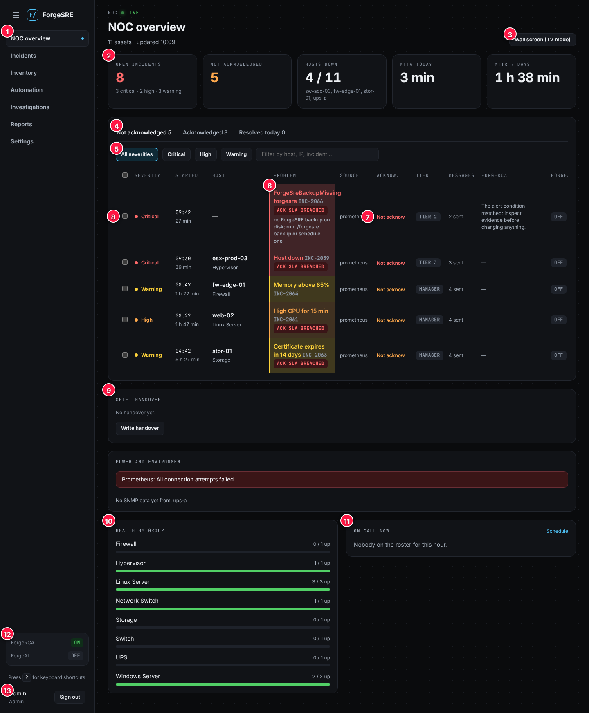
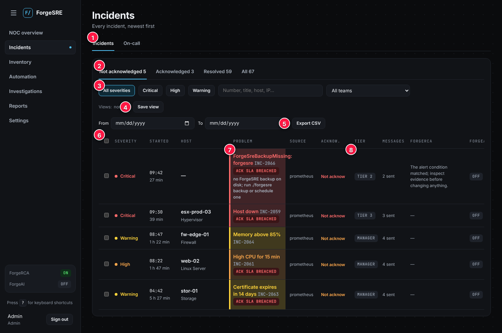
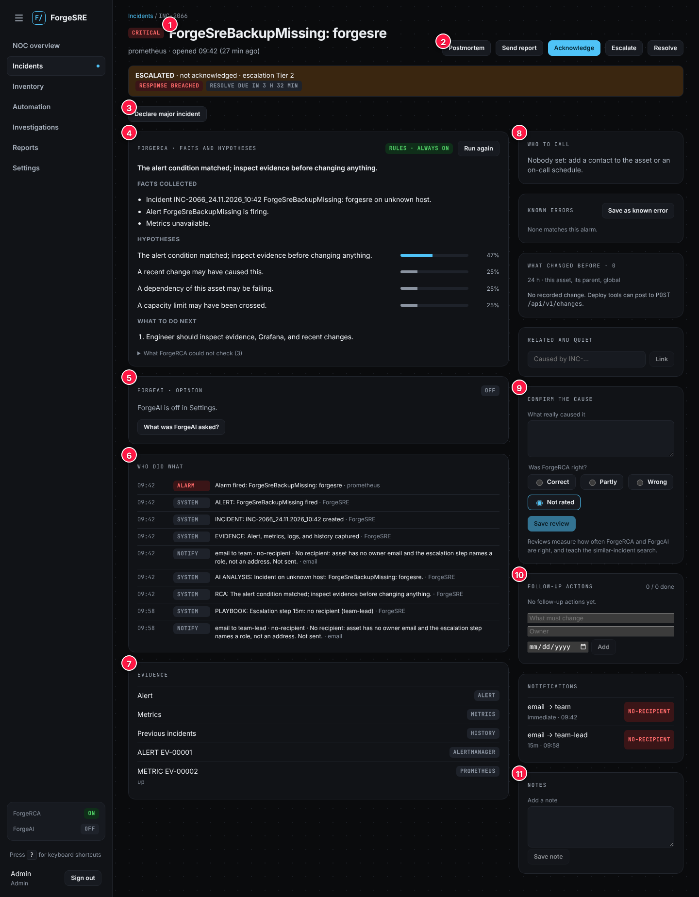
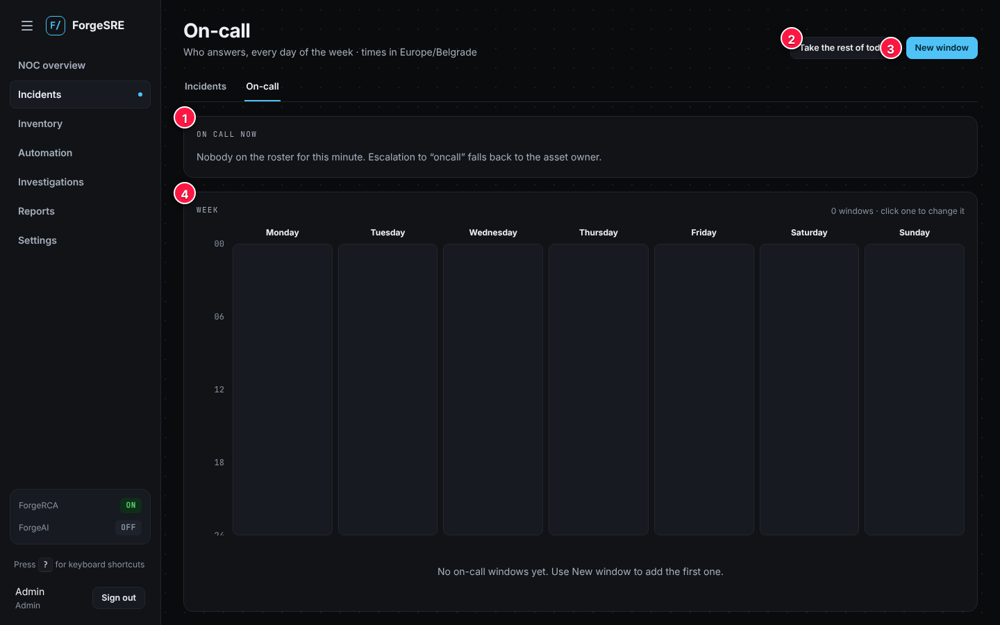
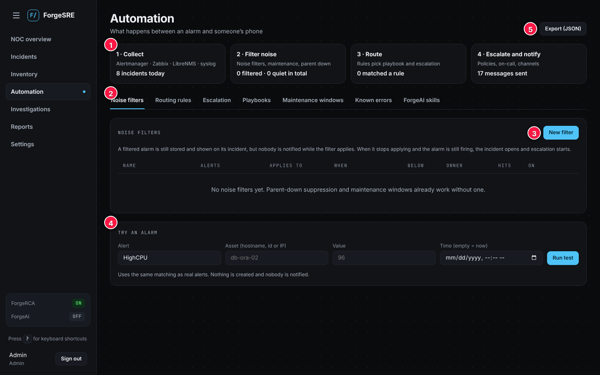
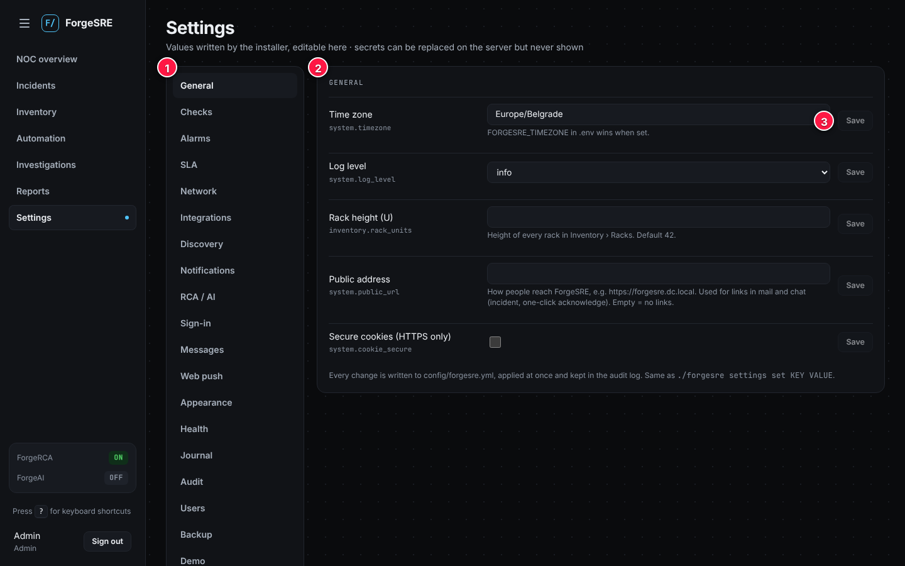
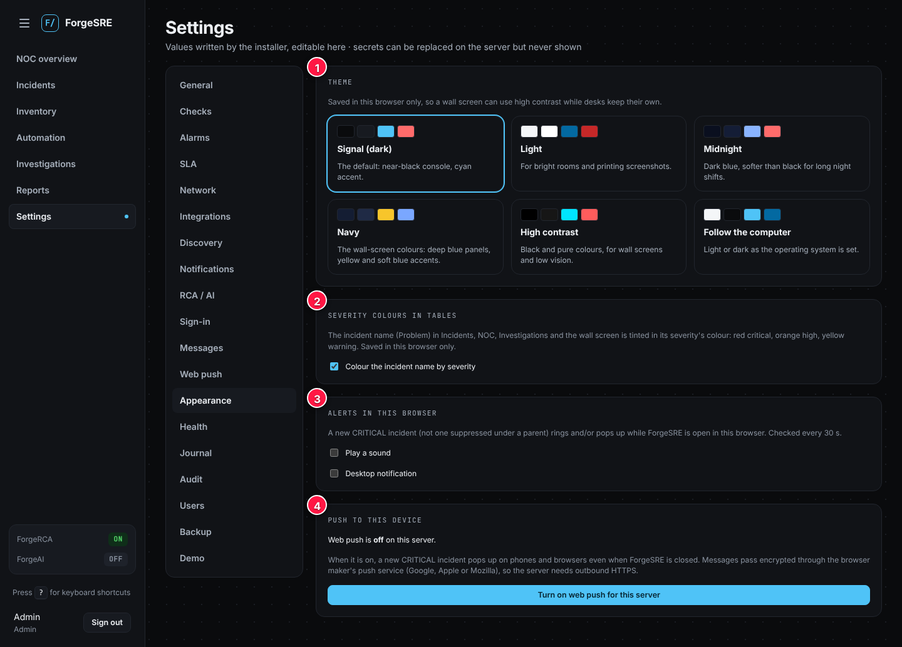
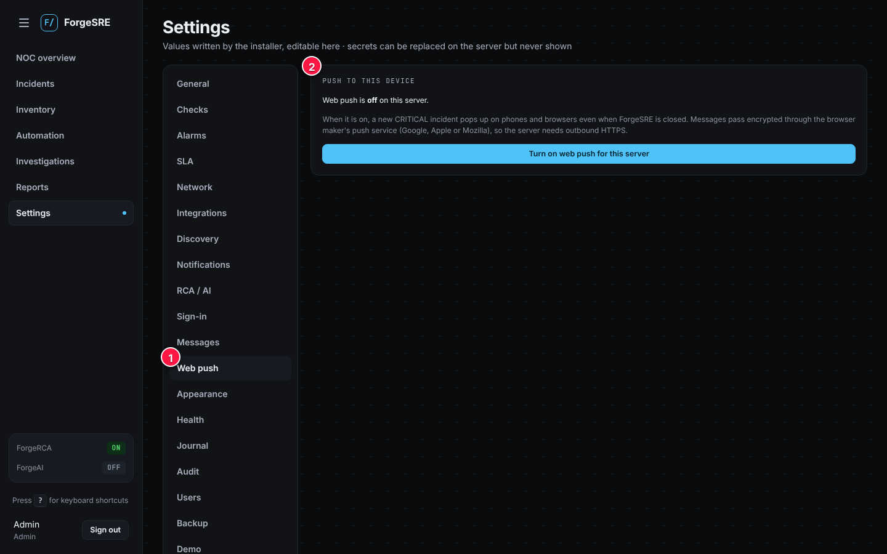

# Visual guide

Each ForgeSRE page with numbered red circles; under the picture, what each number is.
The pictures come from `scripts/visual_guide.py`; Serbian: [vizuelni-vodic-sr.md](vizuelni-vodic-sr.md).

- [NOC overview](#noc)
- [Wall screen (TV mode)](#tv)
- [Incidents](#incidents)
- [Incident page](#incident)
- [On-call](#oncall)
- [Inventory](#inventory)
- [Automation](#automation)
- [Investigations](#investigations)
- [Reports](#reports)
- [Settings](#settings)
- [Settings › Appearance](#settings-appearance)
- [Settings › Web push](#settings-push)

## NOC overview

The start page: what is burning now, who is on call and whether the hosts answer. It refreshes by itself.

1. Main menu: move between pages; the dot shows where you are. Ctrl+K searches pages, incidents and hosts.
2. Today's numbers: open incidents, not acknowledged, hosts down, time to acknowledge and to resolve.
3. Opens the wall screen for a TV in the NOC room.
4. Tabs: not acknowledged, acknowledged, resolved today. The number is how many.
5. Filter by severity, or type a host, IP or incident number.
6. The incident name, coloured by severity (red critical, orange high, yellow warning). Click it to open the incident.
7. Acknow.: Not acknow means nobody has taken it yet; acknowledge it so escalation stops. Who acknowledged it is on the incident page.
8. Tick rows to acknowledge, assign or resolve several at once.
9. Shift handover: write what the next shift must know.
10. Hosts by group: green when all answer.
11. Who is on call right now; Schedule opens the roster.
12. ForgeRCA (rules, always on) and ForgeAI (the local model) status.
13. Who is signed in, the role, and Sign out.

## Wall screen (TV mode)

One screen for the TV on the wall. Sign it in with a Viewer account. Refreshes every 30 s.

1. Time, open, not acknowledged, critical, hosts down, who is on call, and Live (red No updates when the screen stopped refreshing).
2. Burning now: critical first, unacknowledged before acknowledged. More than eight are paged every 15 s.
3. Incident name in its severity colour.
4. Who acknowledged it, or red not acked.
5. The last 7 days like a weather forecast. Click a day to see its clock: ‹ AM left, PM › right.
6. The last 12 hours on a clock: each hour stacked by severity; the hand is now.
7. Host groups: green all up, red with up/total.
8. Last 24 hours: the line is open incidents, the bars are new ones by severity with the count under them.
9. Small tiles: acknowledge and resolve times, backup, noisiest asset, ForgeAI, hosts, new devices; Shift at the far right.
10. Back to the normal UI.

## Incidents

Every incident, newest first, with filters, saved views and CSV export.

1. Incidents and On-call (the roster).
2. By state: not acknowledged, acknowledged, resolved, all.
3. Severity, search and team filters.
4. Save the current filters as a view to open again later.
5. Pick dates and export the list as CSV.
6. Columns: severity, start, host, problem, source, Acknow. (acknowledged), tier, messages sent, ForgeRCA and ForgeAI.
7. The incident name in its severity colour; badges show SLA breached, flapping or major.
8. Tier: how far escalation has gone.

## Incident page

Everything about one incident: what happened, what ForgeRCA thinks, who did what.

1. Severity and name; source and when it opened under it.
2. Actions: postmortem, send report, Acknowledge, Escalate, Resolve.
3. Declare a major incident: a commander and regular updates.
4. ForgeRCA: facts collected, hypotheses with weights, what to do next.
5. ForgeAI: the local model's opinion (when it is on).
6. Timeline: alarm, notifications, acknowledgements and notes, with the time.
7. Evidence captured when it opened: alert, metrics, history.
8. Who to call for this asset.
9. After the fix: write the real cause and rate ForgeRCA.
10. Follow-up actions with an owner and a date.
11. Notes for the team.

## On-call

Who answers, every day of the week, in the appliance's time zone.

1. Who is on call this minute.
2. Take the rest of today yourself.
3. Add a window: who, which days, from and to.
4. The week: click a window to change it.

## Inventory

One record per asset, with state, location and owner.

1. Add devices: scan a range or type them in.
2. Dependency map, racks, sources, new asset, CSV import, list or tree, export.
3. Groups: by location, type, environment, and ready views such as Down now.
4. Search by hostname, IP, owner, rack or customer.
5. State: Alarm (open incident), Down, Up or Not probed.
6. Hostname: click it to open the asset.
7. Pages and rows per page.

## Automation

What happens between an alarm and someone's phone, in four steps.

1. The pipeline: collect, filter noise, route, escalate and notify, with today's numbers.
2. Tabs: noise filters, routing rules, escalation, playbooks, maintenance, known errors, ForgeAI skills.
3. New noise filter: who is not woken up, and when.
4. Try an alarm: see what would happen, without creating anything.
5. Export all rules as JSON.

## Investigations

Resolved incidents with their confirmed cause, how well ForgeRCA and ForgeAI did, and Ask ForgeAI.

1. Search by host, alert or cause; period; only with ForgeAI or only with a confirmed cause.
2. The problem in its severity colour.
3. The confirmed cause, or not reviewed.
4. How often ForgeRCA and ForgeAI were right.
5. Causes that keep coming back, and on which hosts.
6. Ask ForgeAI: chat about anything or one incident (local model).

## Reports

Numbers for a period against the period before, charts and scheduled reports.

1. Period (7, 30, 90 days) and CSV export.
2. Incidents, criticals, MTTA, MTTR and confirmed causes, with the change against the period before.
3. SLOs and error budget.
4. Switch the chart: Today (per hour), 7 days, 4 weeks (per week), 30 days.
5. Bars stacked by severity: red critical, orange high, blue other.
6. Scheduled reports by mail; Preview shows one before it goes out.
7. Breakdown by asset type.
8. Assets with the most incidents.

## Settings

Admins change settings here; others pick a theme and see health.

1. Sections: general, checks, alarms, integrations, notifications, AI, web push, appearance, health, users, backup…
2. The settings of the chosen section. Save writes config/forgesre.yml and the audit log.
3. Save one value.

## Settings › Appearance

Per browser: theme, severity colours, alerts and push.

1. Colour theme for this browser.
2. Colour the incident name by severity (on or off).
3. Sound and desktop notification for a new critical while the page is open.
4. Web push to this phone or browser, even when ForgeSRE is closed.

## Settings › Web push

Turn web push on for the server, then sign up each phone or browser.

1. The Web push section.
2. Off: an Admin turns it on with one button. On: tick Push to this device and Send a test.
