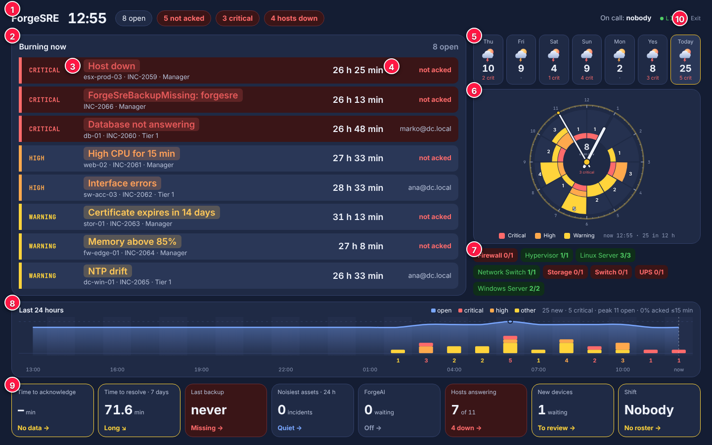
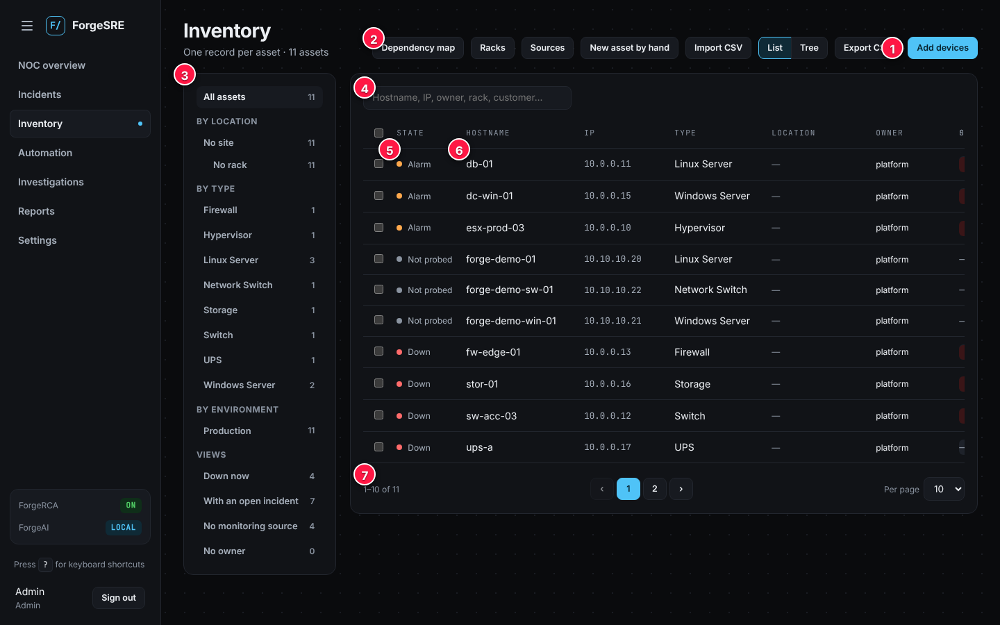
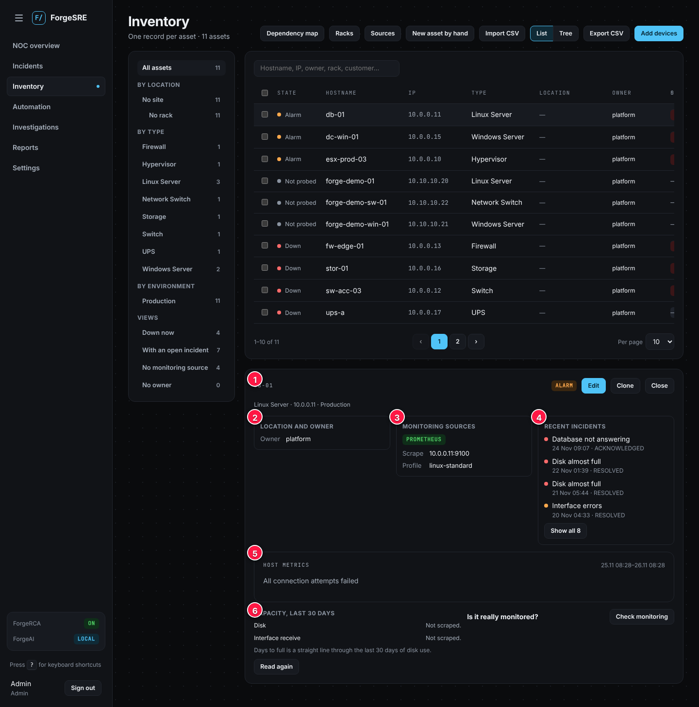
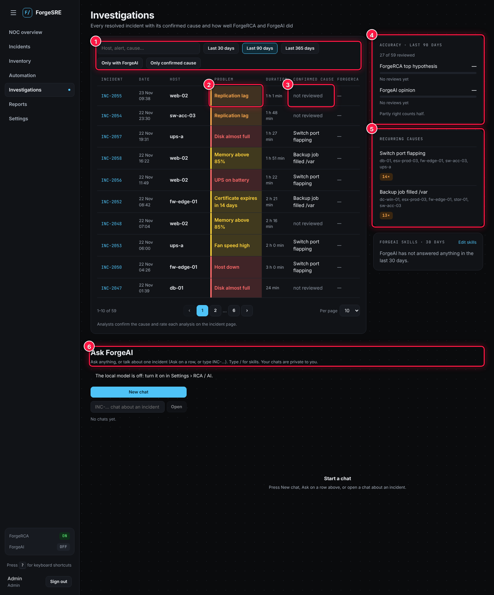
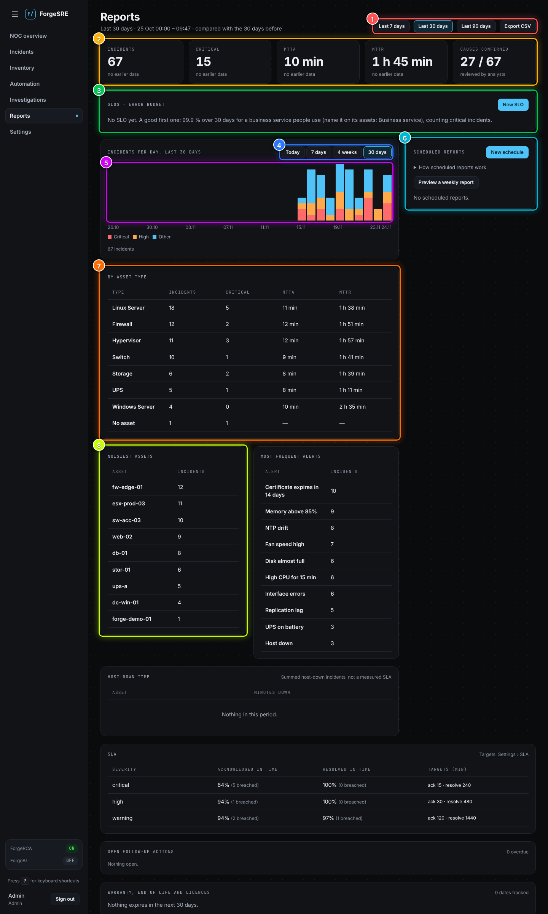
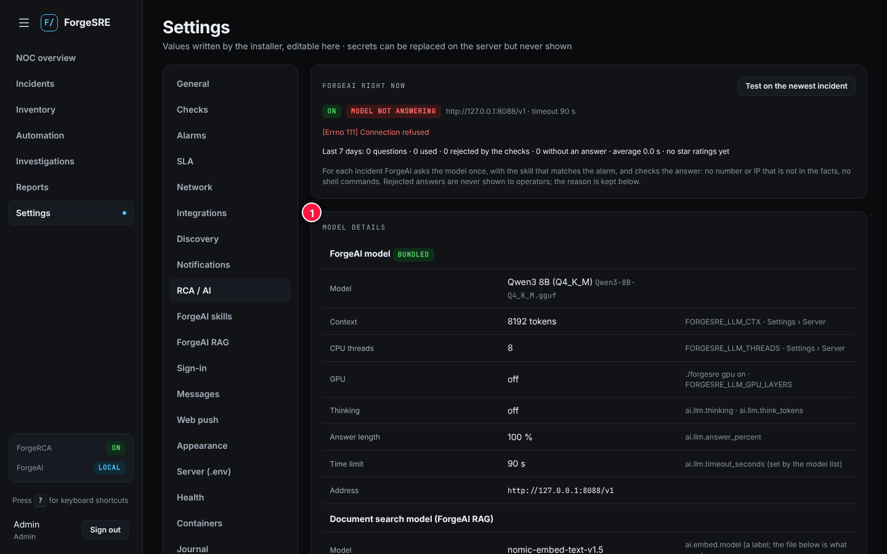

# Visual guide

Each ForgeSRE page with numbered red circles; under the picture, what each number is.
The pictures come from `scripts/visual_guide.py`; Serbian: [vizuelni-vodic-sr.md](vizuelni-vodic-sr.md).

- [NOC overview](#noc)
- [NOC › ForgeAI analysis row](#noc-forgeai)
- [Wall screen (TV mode)](#tv)
- [Incidents](#incidents)
- [Incident page](#incident)
- [On-call](#oncall)
- [Inventory](#inventory)
- [Inventory › asset card](#inventory-asset)
- [Automation](#automation)
- [Investigations](#investigations)
- [Reports](#reports)
- [Settings](#settings)
- [Settings › Appearance](#settings-appearance)
- [Settings › RCA / AI](#settings-ai)
- [Settings › Server (.env)](#settings-server)
- [Settings › Containers](#settings-containers)
- [Settings › ForgeAI RAG](#settings-rag)
- [Settings › Web push](#settings-push)

## NOC overview

The start page: what is burning now, who is on call and whether the hosts answer. It refreshes by itself.

1. Main menu: move between pages; the dot shows where you are. Ctrl+K searches pages, incidents and hosts.
2. Today's numbers: open incidents, not acknowledged, hosts down, time to acknowledge and to resolve.
3. Opens the wall screen for a TV in the NOC room.
4. Tabs: not acknowledged, acknowledged, resolved today. The number is how many.
5. Filter by severity, or type a host, IP or incident number.
6. The incident name, coloured by severity (red critical, orange high, yellow warning). Click it to open the incident.
7. Acknow.: Not acknow means nobody has taken it yet; acknowledge it so escalation stops. Who acknowledged it is on the incident page.
8. ForgeAI: green Analysed, yellow Waiting or Analysing, red Failed or Not analysed, blue Grouped. Click opens its analysis under the row.
9. Tick rows to acknowledge, assign or resolve several at once.
10. Shift: who is on call now and whether the handover was taken over; the link opens the Shift card.
11. ForgeRCA (rules, always on) and ForgeAI (the local model) status.
12. Who is signed in, the role, and Sign out.

## NOC › ForgeAI analysis row

ForgeAI analyses every new incident by itself, one at a time (critical first); a click on its cell opens the answer under the incident.

1. Click: open or close the analysis of this incident.
2. Likely cause, first checks, summary, model and time; while ForgeAI works, ForgeRCA's cause. Advisory: check it against the facts.
3. Open the incident; for a failed, missing or grouped one, Analyse now / Try again / Analyse this one on its own.

## Wall screen (TV mode)

One screen for the TV on the wall. Sign it in with a Viewer account. Refreshes every 30 s.

1. Time, open, not acknowledged, critical, hosts down, who is on call, and Live (red No updates when the screen stopped refreshing).
2. Burning now: critical first, unacknowledged before acknowledged. More than eight are paged every 15 s.
3. Incident name in its severity colour.
4. Who acknowledged it, or red not acked.
5. The last 7 days like a weather forecast. Click a day to see its clock: ‹ AM left, PM › right.
6. The last 12 hours on a wall clock with hour and minute hands: each hour stacked by severity, its count written inside.
7. Host groups: green all up, red with up/total.
8. Last 24 hours: the line is open incidents, the bars are new ones by severity with the count under them.
9. Small tiles: acknowledge and resolve times, backup, noisiest asset, ForgeAI, hosts, new devices; Shift at the far right.
10. Back to the normal UI.

## Incidents

Every incident, newest first, with filters, saved views and CSV export.

1. Incidents and On-call (the roster).
2. By state: not acknowledged, acknowledged, resolved, all.
3. Severity, search and team filters.
4. Save the current filters as a view to open again later.
5. Pick dates and export the list as CSV.
6. Columns: severity, start, host, problem, source, Acknow. (acknowledged), tier, messages sent, ForgeRCA and ForgeAI.
7. The incident name in its severity colour; badges show SLA breached, flapping or major.
8. Tier: how far escalation has gone.

## Incident page

Everything about one incident: what happened, what ForgeRCA thinks, who did what.

1. Severity and name; source and when it opened under it.
2. Actions: incident review, send report, Acknowledge, Escalate, Resolve.
3. Declare a major incident: a commander and regular updates.
4. ForgeRCA: facts collected, hypotheses with weights, what to do next.
5. ForgeAI: the local model's opinion (when it is on).
6. Timeline: alarm, notifications, acknowledgements and notes, with the time.
7. Evidence captured when it opened: alert, metrics, history.
8. Who to call for this asset.
9. After the fix: write the real cause and rate ForgeRCA.
10. Follow-up actions with an owner and a date.
11. Notes for the team.

## On-call

Who answers, every day of the week, in the appliance's time zone.

1. Shift: on call now, the handover (write, take over) and the ForgeAI draft that can fill it.
2. Take the rest of today yourself.
3. Add a window: who, which days, from and to.
4. The week: click a window to change it.

## Inventory

One record per asset, with state, location and owner.

1. Add devices: scan a range or type them in.
2. Dependency map, racks, sources, new asset, CSV import, list or tree, export.
3. Groups: by location, type, environment, and ready views such as Down now.
4. Search by hostname, IP, owner, rack or customer.
5. State: Alarm (open incident), Down, Up or Not probed.
6. Hostname: click it to open the asset.
7. Pages and rows per page.

## Inventory › asset card

A click on a hostname opens its card under the table, as wide as the table.

1. Header: state, Edit, Clone and Close.
2. Location and owner, with the contact.
3. What watches it: Prometheus, SNMP, Zabbix, GLPI.
4. Recent incidents; Show all for the rest.
5. Host metrics of the last hour, six small charts to a row.
6. Capacity over 30 days and days until the disk is full.

## Automation

What happens between an alarm and someone's phone, in four steps.

1. The pipeline: collect, filter noise, route, escalate and notify, with today's numbers.
2. Tabs: noise filters, routing rules, escalation, playbooks, maintenance windows, known errors.
3. New noise filter: who is not woken up, and when.
4. Try an alarm: see what would happen, without creating anything.
5. Export all rules as JSON.

## Investigations

Resolved incidents with their confirmed cause, how well ForgeRCA and ForgeAI did, and Ask ForgeAI.

1. Search by host, alert or cause; period; only with ForgeAI or only with a confirmed cause.
2. The problem in its severity colour.
3. The confirmed cause, or not reviewed.
4. How often ForgeRCA and ForgeAI were right.
5. Causes that keep coming back, and on which hosts.
6. Ask ForgeAI: chat about anything or one incident (local model).
7. Model: which downloaded or imported model answers; an Engineer switches it here for everyone.
8. Answers: Strict, Balanced or Open for a chat about an incident; without an incident, general knowledge.

## Reports

One period for the whole page, then five sections: summary, sources, service levels, follow-up, sending reports.

1. Period for everything on the page: Today, 7, 30 or 90 days; Export CSV exports the same period.
2. Jump to a section.
3. Incidents, criticals, MTTA, MTTR and confirmed causes, with the change against the period before.
4. The chart for the same period: per hour today, per day for 7 or 30 days, per week for 90 days.
5. Where incidents come from: asset types, noisiest assets, frequent alerts, alert quality, host-down time.
6. SLA (how fast the team reacts) and SLO (how available a service is), explained, with their cards below.
7. Follow-up actions still open, and hardware or licences running out.
8. Scheduled reports by mail and the outbox of every message sent.

## Settings

Admins change settings here; others pick a theme and see health.

1. Sections: general, checks, alarms, integrations, notifications, RCA / AI, ForgeAI skills, ForgeAI RAG, web push, appearance, health, users, backup…
2. The settings of the chosen section. Save writes config/forgesre.yml and the audit log.
3. Save one value.

## Settings › Appearance

Per browser: theme, severity colours, alerts and push.

1. Colour theme for this browser.
2. Colour the incident name by severity (on or off).
3. Sound and desktop notification for a new critical while the page is open.
4. Web push to this phone or browser, even when ForgeSRE is closed.

## Settings › RCA / AI

ForgeAI on or off, which model runs and how, and the model list.

1. Model details: the model file, context, threads, GPU, thinking, answer length, and the document-search model.
2. Model list: Qwen3, Llama, Qwen2.5 and OpsLLM, smaller to stronger; Download, then Use.

## Settings › Server (.env)

Every .env value by part of the appliance; safe ones change here and the apply helper restarts only what uses them.

1. Apply helper on or off; when off, values are shown only (./forgesre apply-helper on).
2. One part of the appliance: each value with its range and which containers restart.
3. Secrets only as set / not set, with the command to replace one on the server.

## Settings › Containers

Every container with its state, and the last lines of its log. Read only.

1. State and health of each container; a finished one-shot job shows as finished.
2. Logs: the last 100–1000 lines, filter, Errors only; passwords and tokens masked.

## Settings › ForgeAI RAG

The manuals and runbooks ForgeAI may quote, and how much they are used.

1. Documents, pieces and pages, how many ForgeAI questions got excerpts and how many answers cited them (7 days).
2. Drop files here (several at once) or pick them; a title names a single file.
3. Search on: the local embedding model answers. Off: the banner says how to start it.

## Settings › Web push

Turn web push on for the server, then sign up each phone or browser.

1. The Web push section.
2. Off: an Admin turns it on with one button. On: tick Push to this device and Send a test.
