# Vizuelni vodič

Svaka stranica ForgeSRE-a sa crvenim brojevima; ispod slike piše šta je koji broj.
Slike pravi `scripts/visual_guide.py`; engleska verzija: [visual-guide.md](visual-guide.md).

- [NOC pregled](#noc)
- [NOC › red sa ForgeAI analizom](#noc-forgeai)
- [Zidni ekran (TV mod)](#tv)
- [Incidenti](#incidents)
- [Stranica incidenta](#incident)
- [Dežurstva](#oncall)
- [Inventar](#inventory)
- [Inventar › kartica uređaja](#inventory-asset)
- [Automatizacija](#automation)
- [Istrage](#investigations)
- [Izveštaji](#reports)
- [Podešavanja](#settings)
- [Podešavanja › Izgled](#settings-appearance)
- [Podešavanja › RCA / AI](#settings-ai)
- [Podešavanja › Server (.env)](#settings-server)
- [Podešavanja › Containers](#settings-containers)
- [Podešavanja › ForgeAI RAG](#settings-rag)
- [Podešavanja › Web push](#settings-push)

## NOC pregled

Početna strana: šta gori sada, ko je dežuran i da li hostovi odgovaraju. Sama se osvežava.

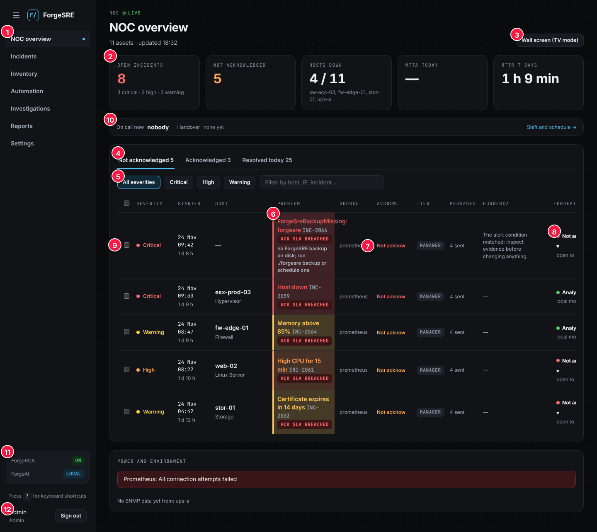

1. Glavni meni: prelaz između stranica; tačka pokazuje gde si. Ctrl+K pretražuje stranice, incidente i hostove.
2. Brojke za danas: otvoreni incidenti, nepotvrđeni, hostovi koji ne rade, vreme do potvrde i do rešenja.
3. Otvara zidni ekran za TV u NOC sobi.
4. Tabovi: nepotvrđeni, potvrđeni, rešeni danas. Broj pokazuje koliko ih ima.
5. Filter po ozbiljnosti, ili ukucaj host, IP ili broj incidenta.
6. Ime incidenta, obojeno po ozbiljnosti (crveno kritično, narandžasto visoko, žuto upozorenje). Klik otvara incident.
7. Acknow.: Not acknow znači da ga niko još nije preuzeo; potvrdi ga da eskalacija stane. Ko ga je potvrdio piše na stranici incidenta.
8. ForgeAI: zeleno Analysed, žuto Waiting ili Analysing, crveno Failed ili Not analysed, plavo Grouped. Klik otvara analizu ispod reda.
9. Čekiraj redove da potvrdiš, dodeliš ili rešiš više odjednom.
10. Smena: ko je dežuran sada i da li je primopredaja preuzeta; link otvara karticu Shift.
11. Stanje ForgeRCA (pravila, uvek uključen) i ForgeAI (lokalni model).
12. Ko je prijavljen, uloga i odjava (Sign out).

## NOC › red sa ForgeAI analizom

ForgeAI sam analizira svaki novi incident, jedan po jedan (prvo kritični); klik na njegovu ćeliju otvara odgovor ispod incidenta.

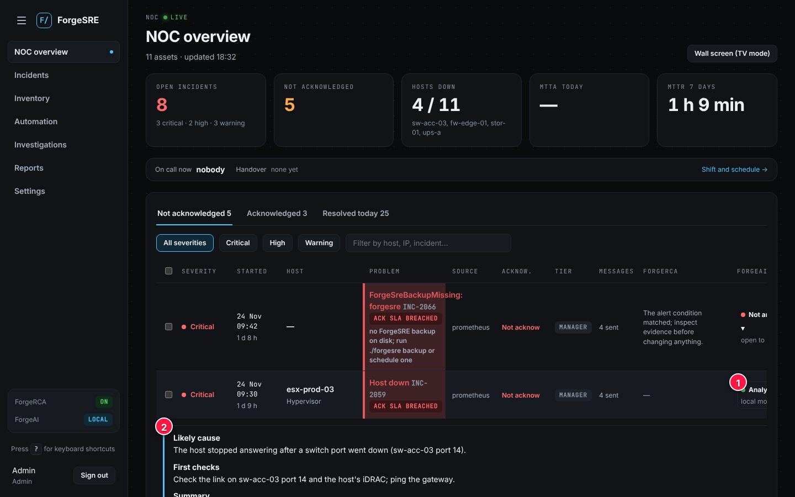

1. Klik: otvori ili zatvori analizu ovog incidenta.
2. Verovatan uzrok, prve provere, sažetak, model i vreme; dok ForgeAI radi, uzrok iz ForgeRCA. Savet: proveri ga prema činjenicama.
3. Otvori incident; za neuspelu, nepostojeću ili grupisanu analizu: Analyse now / Try again / Analyse this one on its own.

## Zidni ekran (TV mod)

Jedan ekran za TV na zidu. Prijavi ga Viewer nalogom. Osvežava se na 30 s.

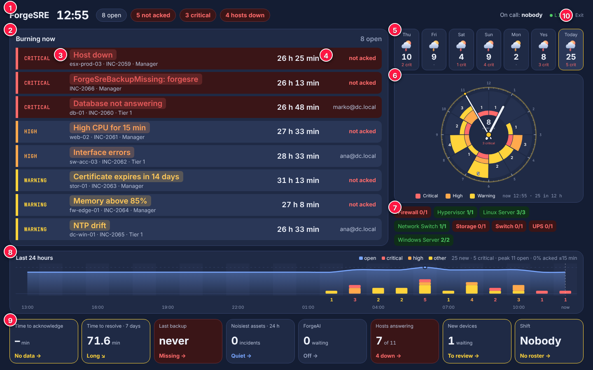

1. Vreme, otvoreni, nepotvrđeni, kritični, hostovi koji ne rade, ko je dežuran i Live (crveno No updates kad ekran prestane da se osvežava).
2. Burning now: prvo kritični, nepotvrđeni pre potvrđenih. Više od osam se lista po stranama na 15 s.
3. Ime incidenta u boji ozbiljnosti.
4. Ko ga je potvrdio, ili crveno not acked.
5. Poslednjih 7 dana kao vremenska prognoza. Klik na dan prikazuje njegov sat: ‹ AM levo, PM › desno.
6. Poslednjih 12 sati na satu sa velikom i malom kazaljkom: svaki sat složen po ozbiljnosti, sa brojem incidenata unutra.
7. Grupe hostova: zeleno svi rade, crveno sa radi/ukupno.
8. Poslednja 24 sata: linija su otvoreni incidenti, stubići su novi po ozbiljnosti sa brojem ispod.
9. Male pločice: vreme potvrde i rešenja, backup, najbučniji uređaj, ForgeAI, hostovi, novi uređaji; Shift skroz desno.
10. Povratak u običan prikaz.

## Incidenti

Svi incidenti, najnoviji prvi, sa filterima, sačuvanim prikazima i CSV izvozom.

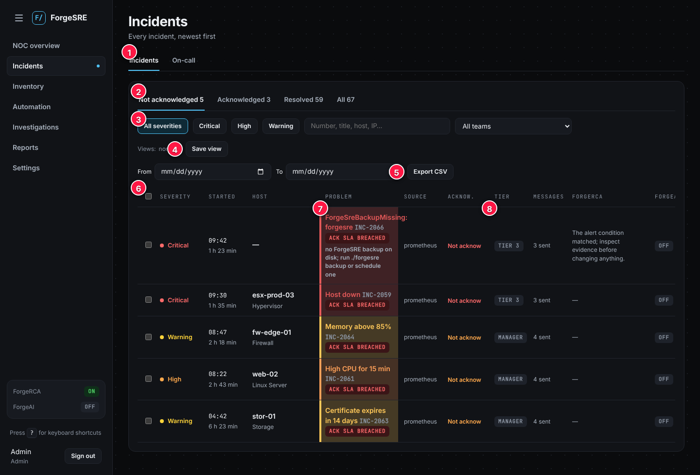

1. Incidenti i On-call (raspored dežurstava).
2. Po stanju: nepotvrđeni, potvrđeni, rešeni, svi.
3. Filteri: ozbiljnost, pretraga i tim.
4. Sačuvaj trenutne filtere kao prikaz za kasnije.
5. Izaberi datume i izvezi listu u CSV.
6. Kolone: ozbiljnost, početak, host, problem, izvor, potvrda, nivo eskalacije, poslate poruke, ForgeRCA i ForgeAI.
7. Ime incidenta u boji ozbiljnosti; oznake pokazuju probijen SLA, flapping ili major.
8. Nivo: dokle je stigla eskalacija.

## Stranica incidenta

Sve o jednom incidentu: šta se desilo, šta misli ForgeRCA, ko je šta uradio.

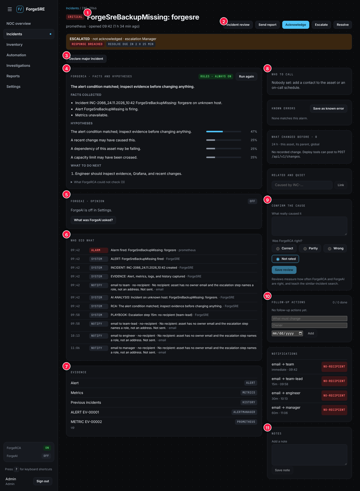

1. Ozbiljnost i ime; ispod izvor i kada je otvoren.
2. Akcije: incident review, slanje izveštaja, Acknowledge (potvrdi), Escalate (eskaliraj), Resolve (reši).
3. Proglasi veliki incident: komandant i redovna obaveštenja.
4. ForgeRCA: prikupljene činjenice, hipoteze sa težinama, šta dalje.
5. ForgeAI: mišljenje lokalnog modela (kad je uključen).
6. Hronologija: alarm, obaveštenja, potvrde i beleške, sa vremenom.
7. Dokazi prikupljeni pri otvaranju: alarm, metrike, istorija.
8. Koga zvati za ovaj uređaj.
9. Posle popravke: upiši pravi uzrok i oceni ForgeRCA.
10. Naknadne akcije sa vlasnikom i rokom.
11. Beleške za tim.

## Dežurstva

Ko odgovara, svaki dan u nedelji, po vremenu servera.

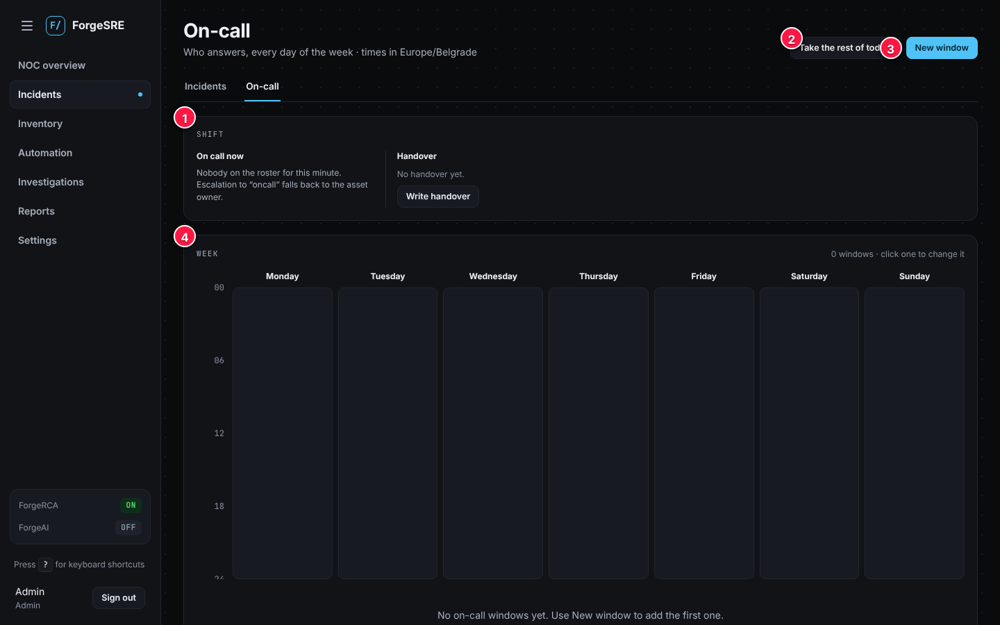

1. Smena: ko je dežuran, primopredaja (napiši, preuzmi) i ForgeAI nacrt koji može da je popuni.
2. Preuzmi ostatak dana na sebe.
3. Dodaj termin: ko, koji dani, od i do.
4. Nedelja: klik na termin da ga izmeniš.

## Inventar

Jedan zapis po uređaju, sa stanjem, lokacijom i vlasnikom.

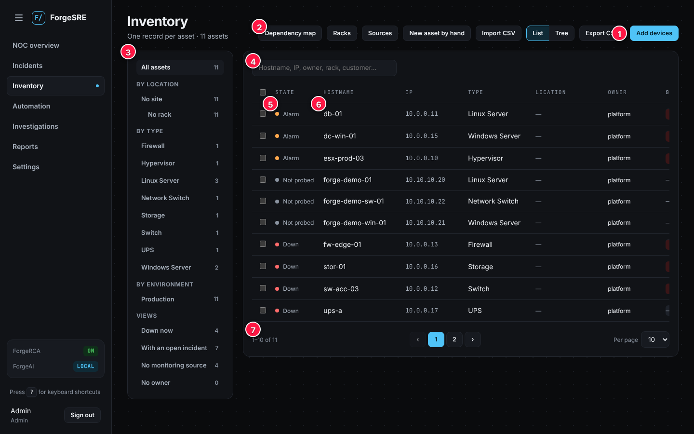

1. Dodaj uređaje: skeniraj opseg ili ih upiši.
2. Mapa zavisnosti, rekovi, izvori, novi uređaj, uvoz CSV, lista ili stablo, izvoz.
3. Grupe: po lokaciji, tipu, okruženju, i gotovi prikazi kao Down now.
4. Pretraga po imenu, IP-u, vlasniku, reku ili korisniku.
5. Stanje: Alarm (otvoren incident), Down, Up ili Not probed.
6. Ime: klik otvara uređaj.
7. Strane i broj redova po strani.

## Inventar › kartica uređaja

Klik na ime uređaja otvara njegovu karticu ispod tabele, široku kao tabela.

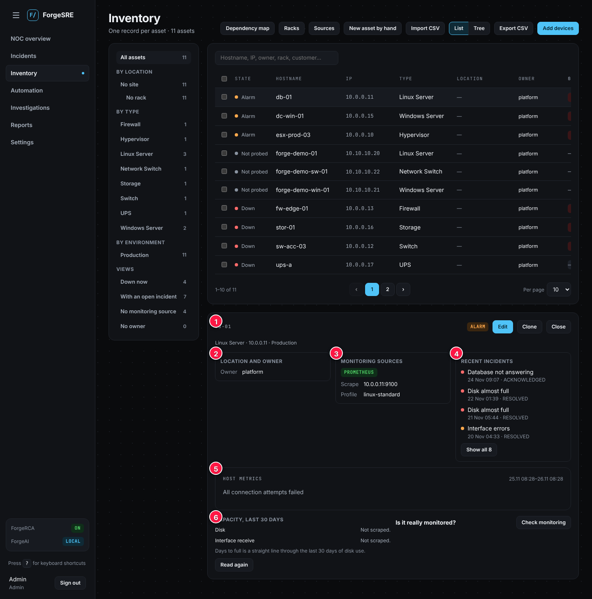

1. Zaglavlje: stanje, Edit, Clone i Close.
2. Lokacija i vlasnik, sa kontaktom.
3. Šta ga prati: Prometheus, SNMP, Zabbix, GLPI.
4. Skorašnji incidenti; Show all za ostale.
5. Metrike hosta za poslednji sat, šest malih grafikona u redu.
6. Kapacitet za 30 dana i broj dana do punog diska.

## Automatizacija

Šta se dešava između alarma i nečijeg telefona, u četiri koraka.

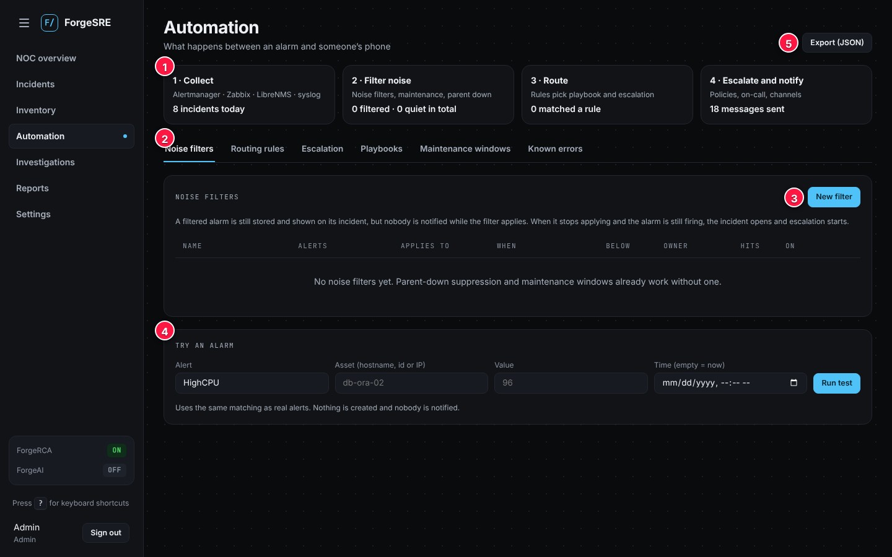

1. Tok: prikupljanje, filtriranje šuma, rutiranje, eskalacija i obaveštenja, sa današnjim brojkama.
2. Tabovi: filteri šuma, pravila rutiranja, eskalacija, playbook-ovi, prozori održavanja, poznate greške.
3. Novi filter šuma: koga ne budimo i kada.
4. Probaj alarm: vidi šta bi se desilo, bez pravljenja ičega.
5. Izvezi sva pravila kao JSON.

## Istrage

Rešeni incidenti sa potvrđenim uzrokom, koliko su ForgeRCA i ForgeAI bili tačni, i Ask ForgeAI.

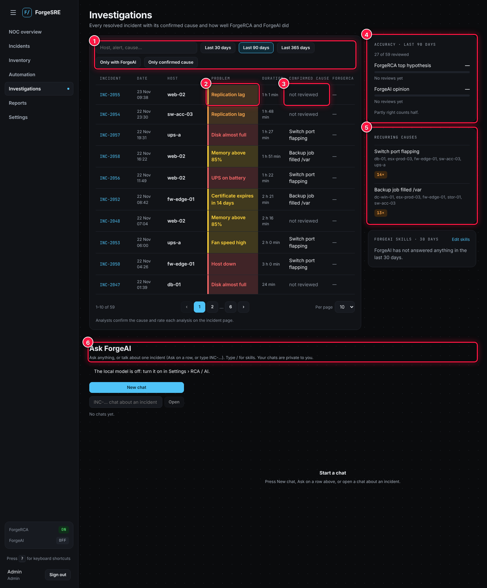

1. Pretraga po hostu, alarmu ili uzroku; period; samo sa ForgeAI ili samo sa potvrđenim uzrokom.
2. Problem u boji ozbiljnosti.
3. Potvrđeni uzrok, ili not reviewed.
4. Koliko često su ForgeRCA i ForgeAI bili u pravu.
5. Uzroci koji se ponavljaju, i na kojim hostovima.
6. Ask ForgeAI: razgovor o bilo čemu ili o jednom incidentu (lokalni model).
7. Model: koji skinuti ili uvezeni model odgovara; Engineer ga ovde menja za sve.
8. Answers: Strict, Balanced ili Open za chat o incidentu; bez incidenta, opšte znanje.

## Izveštaji

Jedan period za celu stranu, pa pet sekcija: pregled, izvori, nivoi usluge, praćenje, slanje izveštaja.

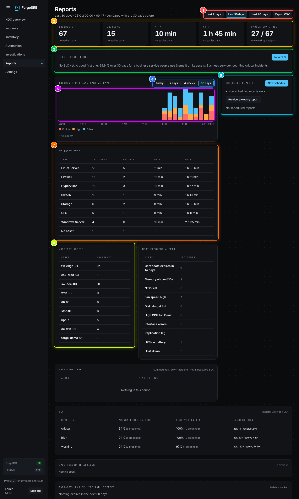

1. Period za sve na strani: Today, 7, 30 ili 90 dana; Export CSV izvozi isti period.
2. Skok na sekciju.
3. Incidenti, kritični, MTTA, MTTR i potvrđeni uzroci, sa promenom u odnosu na prethodni period.
4. Grafikon za isti period: po satu za danas, po danu za 7 ili 30 dana, po nedelji za 90 dana.
5. Odakle dolaze incidenti: tipovi uređaja, najbučniji uređaji, česti alarmi, kvalitet alarma, vreme pada hostova.
6. SLA (koliko brzo tim reaguje) i SLO (koliko je usluga dostupna), objašnjeni, sa karticama ispod.
7. Otvorene naknadne akcije, i hardver ili licence kojima ističe rok.
8. Zakazani izveštaji mejlom i lista svih poslatih poruka.

## Podešavanja

Admin ovde menja podešavanja; ostali biraju temu i vide stanje.

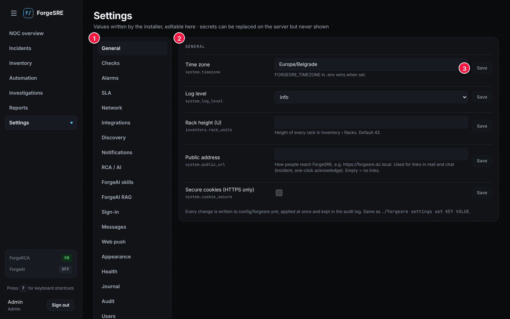

1. Sekcije: opšte, provere, alarmi, integracije, obaveštenja, RCA / AI, ForgeAI skills, ForgeAI RAG, web push, izgled, zdravlje, korisnici, backup…
2. Podešavanja izabrane sekcije. Save upisuje config/forgesre.yml i audit log.
3. Sačuvaj jednu vrednost.

## Podešavanja › Izgled

Za ovaj browser: tema, boje ozbiljnosti, upozorenja i push.

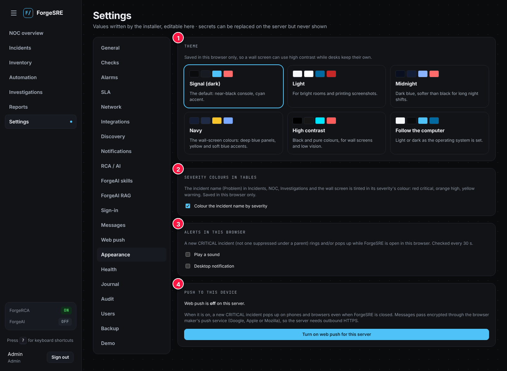

1. Tema boja za ovaj browser.
2. Boji ime incidenta po ozbiljnosti (uključi ili isključi).
3. Zvuk i obaveštenje na desktopu za novi kritični dok je strana otvorena.
4. Web push na ovaj telefon ili browser, i kad je ForgeSRE zatvoren.

## Podešavanja › RCA / AI

ForgeAI uključen ili isključen, koji model radi i kako, i lista modela.

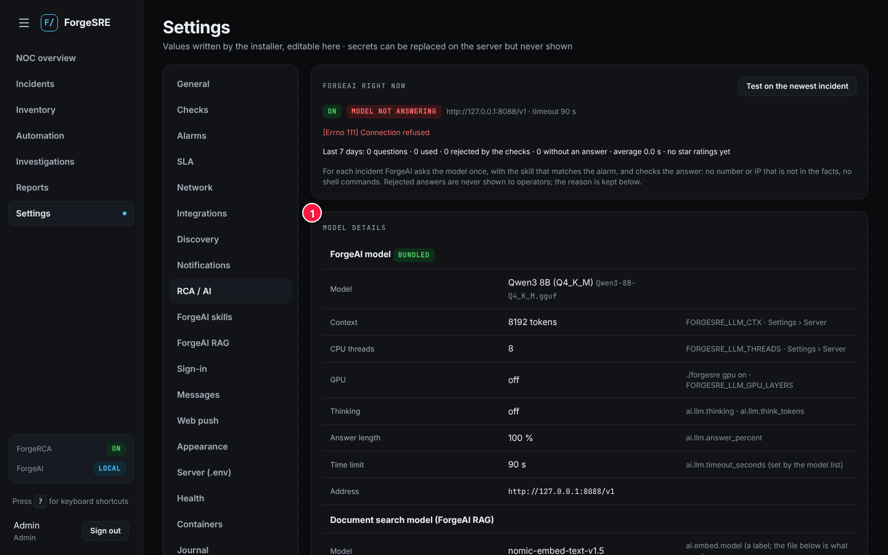

1. Detalji modela: fajl modela, kontekst, niti, GPU, razmišljanje, dužina odgovora, i model za pretragu dokumenata.
2. Lista modela: Qwen3, Llama, Qwen2.5 i OpsLLM, od manjeg ka jačem; Download, pa Use.

## Podešavanja › Server (.env)

Svaka .env vrednost po delu sistema; bezbedne se menjaju ovde, a apply helper restartuje samo ono što ih koristi.

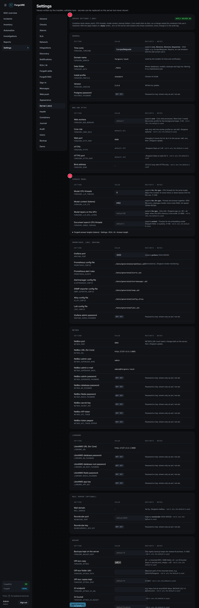

1. Apply helper uključen ili isključen; kad je isključen, vrednosti se samo prikazuju (./forgesre apply-helper on).
2. Jedan deo sistema: svaka vrednost sa opsegom i kontejnerima koji se restartuju.
3. Tajne samo kao set / not set, sa komandom za zamenu na serveru.

## Podešavanja › Containers

Svaki kontejner sa stanjem, i poslednje linije njegovog loga. Samo za čitanje.

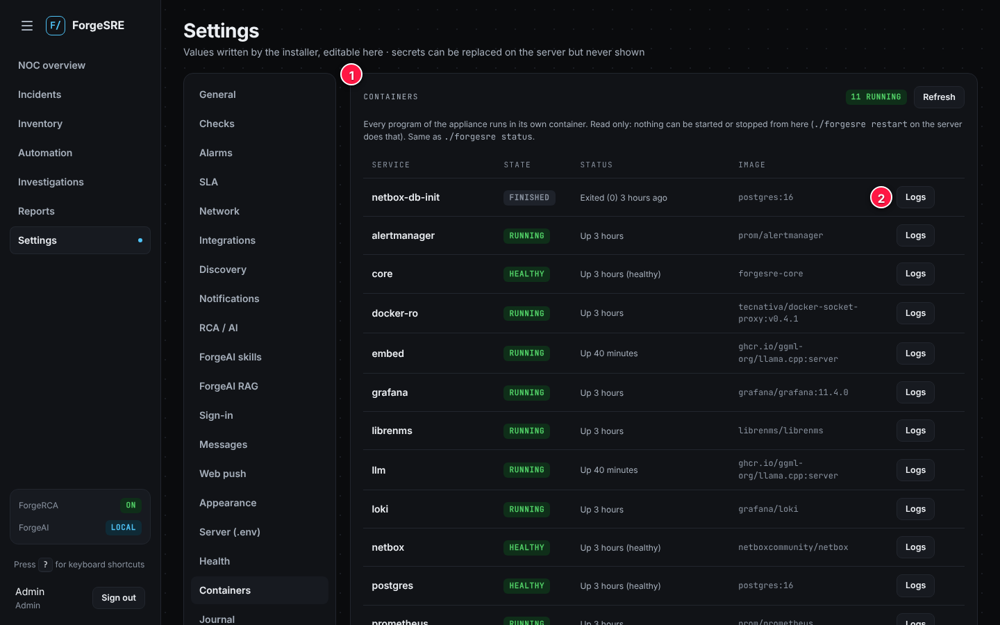

1. Stanje i zdravlje svakog kontejnera; završen jednokratni posao je označen kao finished.
2. Logs: poslednjih 100–1000 linija, filter, Errors only; lozinke i tokeni maskirani.

## Podešavanja › ForgeAI RAG

Priručnici i runbook-ovi koje ForgeAI sme da citira, i koliko se koriste.

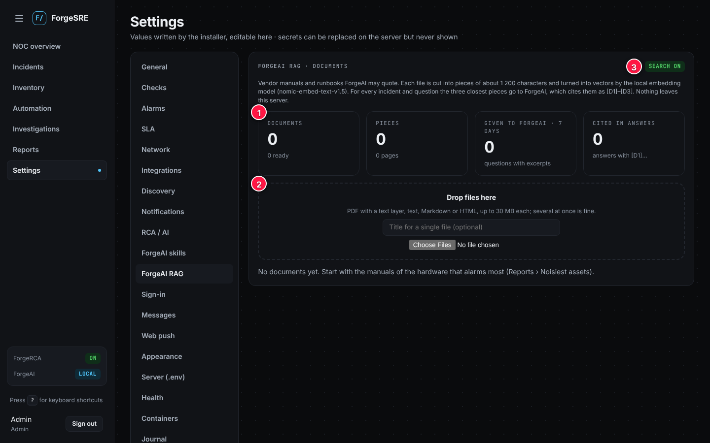

1. Dokumenti, delovi i strane, koliko je ForgeAI pitanja dobilo izvode i koliko je odgovora citiralo (7 dana).
2. Prevuci fajlove ovde (može više odjednom) ili ih izaberi; naslov važi za jedan fajl.
3. Search on: lokalni embedding model radi. Off: poruka kaže kako da se pokrene.

## Podešavanja › Web push

Uključi web push na serveru, pa prijavi svaki telefon ili browser.

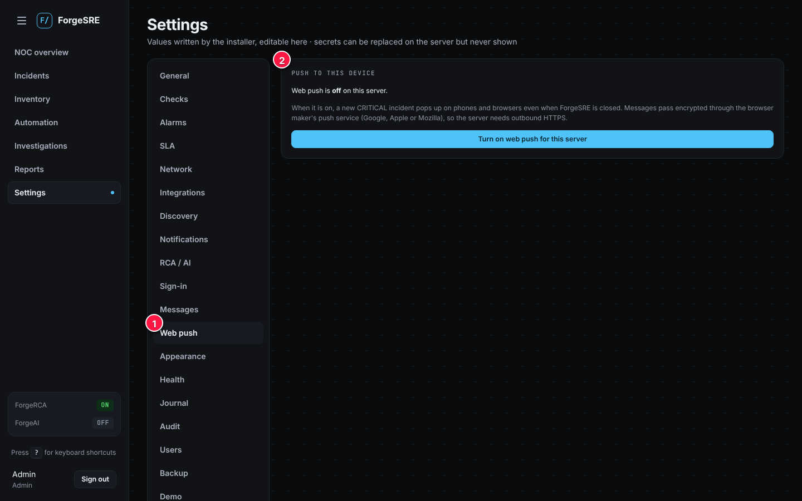

1. Sekcija Web push.
2. Isključen: Admin ga uključuje jednim dugmetom. Uključen: čekiraj Push to this device i Send a test.
