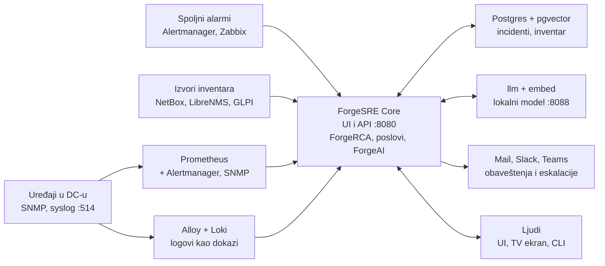

# ForgeSRE 2.0 — vodič za instalaciju, integracije i ForgeAI

Stanje: 23. 11. 2026. Isti dokument, sa komentarima, postoji i kao Claude doc.

ForgeSRE je NOC monitoring platforma za praćenje infrastrukture u datacentrima. Ovaj vodič opisuje kako se instalira, šta se upisuje u `.env`, `secrets/secrets.env` i `config/forgesre.yml`, kako se povezuju spoljni sistemi i kako se podešava ForgeAI (lokalni i cloud jezički model).

## 1. Pregled: šta ForgeSRE pokreće

ForgeSRE je jedan Docker Compose stek na jednoj Ubuntu VM. Svi servisi rade sa `network_mode: host` i slušaju na `127.0.0.1`, osim ForgeSRE Core-a (UI i API), Grafane, NetBox-a, LibreNMS-a i opcionog mail servera. Spolja se vidi samo ono što treba ljudima i uređajima.



Alarmi i logovi ulaze levo, Core ih spaja sa inventarom i čuva u Postgres-u, a ljudi dobijaju incidente, obaveštenja i ForgeAI desno.

| Servis | Port | Profil | Šta radi |
| --- | --- | --- | --- |
| `core` | 8080 (`FORGESRE_HTTP_PORT`) | uvek | UI na `/app`, API, prijem alarma, ForgeRCA, poslovi u pozadini |
| `postgres` | 5432 (samo lokalno) | uvek | Baza ForgeSRE-a: incidenti, inventar, korisnici, podešavanja, ForgeAI pozivi; pgvector za pretragu dokumenata |
| `prometheus` | 9090 (lokalno) | uvek | Metrike i pravila alarma |
| `alertmanager` | 9093 (lokalno) | uvek | Šalje alarme Core-u preko webhook-a |
| `snmp-exporter` | 9116 (lokalno) | uvek | SNMP metrike mrežnih uređaja za Prometheus |
| `loki` | 3100 (lokalno) | uvek | Logovi (syslog) kao dokazi za RCA |
| `alloy` | 514 syslog, 12345 (lokalno) | uvek | Prima syslog i šalje ga u Loki |
| `grafana` | 3000 (`GRAFANA_PORT`) | uvek | Grafikoni, link iz System Health |
| `netbox` + `netbox-redis` + `netbox-db-init` | 8001 (`NETBOX_PORT`) | uvek | Izvor inventara (čita se, ne menja se) |
| `librenms` + `librenms-db` + `librenms-redis` + `librenms-dispatcher` | 8000 | uvek | Otkrivanje uređaja (SNMP identify, portovi, linkovi) |
| `llm` | 8088 (lokalno) | `ai` | llama.cpp sa lokalnim modelom (ForgeAI) |
| `embed` | 8089 (lokalno) | `ai` | Mali model za embeddings (pretraga uploadovanih priručnika) |
| `worker` | — | `worker` | Opciono: petlje u pozadini u posebnom procesu |
| `mailserver`, `roundcube`, `mailbox` | 25, 587, 993, 8081 | `mailbox` | Opciono: sopstveni mail server |

Sve što treba da preživi restart je u `FORGESRE_DATA` (podrazumevano `./data`): Postgres, modeli (`data/models/`), generisana konfiguracija (`data/generated/`), backup-i (`data/backups/`) i logovi. Podešavanja su na tri mesta, svako za svoje: `.env` (portovi, putanje, profili), `secrets/secrets.env` (lozinke i tokeni) i `config/forgesre.yml` (ponašanje platforme, većina se menja iz UI-ja u Settings).

## 2. Pre instalacije

Za platformu bez lokalnog modela dovoljno je 4 vCPU i 8 GB RAM-a; sa lokalnim modelom računaj na 8 vCPU i 16 GB. GPU ne treba, model radi na CPU-u.

| Resurs | Bez ForgeAI | Sa Qwen3 4B | Sa 8B modelom | Sa 14B modelom |
| --- | --- | --- | --- | --- |
| vCPU | 4 (min. 2) | 8 | 8–12 | 12+ |
| RAM | 8 GB (min. 4) | 12–16 GB | 16 GB | 24 GB |
| Disk | 40 GB | + 3 GB | + 5 GB | + 9 GB |
| Vreme jednog odgovora | — | 30–90 s | 1–3 min | nekoliko minuta |

Pripremi:

- Ubuntu Server 22.04 ili 24.04, statičku IP adresu na menadžmentnoj mreži i tačno vreme (NTP).
- Pristup internetu pri prvoj instalaciji (GitHub, Docker registri, Hugging Face za model). Bez interneta: `./install.sh --offline` i model donet ručno (poglavlje 8).
- Otvorene portove ka VM: 8080 (UI), 514/udp i tcp (syslog sa uređaja), 161/udp od VM ka uređajima (SNMP), po želji 3000, 8000 i 8001.
- Adrese i tokene sistema koje povezuješ: Zabbix, GLPI, eksterni NetBox, SMTP server, Slack/Teams/Discord webhook, Kubernetes klasteri, LDAP ili OIDC.
- Na VMware gostu: `open-vm-tools`. Ugnježdena virtualizacija nije potrebna.

## 3. Instalacija i update korak po korak

Nova VM se instalira jednom sa `./install.sh`; postojeća se uvek ažurira sa `./forgesre update`, nikad ponovnom instalacijom (ona bi napravila nove lozinke).

**Priprema hosta (kao root):**

```bash
apt update && apt upgrade -y
apt install -y ca-certificates curl git docker.io docker-compose-v2 open-vm-tools
systemctl enable --now docker
usermod -aG docker "$USER"   # pa se odjavi i prijavi ponovo
git clone https://github.com/nsimic2022/forgesre.git && cd forgesre
```

**Prva instalacija:**

```bash
./install.sh                                   # vođeni čarobnjak
# ili bez pitanja, sa lokalnim modelom:
./install.sh --non-interactive --profile full-ai --port 8080 \
  --timezone Europe/Belgrade --discovery-cidrs 10.20.30.0/24
./forgesre test && ./forgesre doctor
```

Instaler kopira `.env.example` u `.env` i `secrets/secrets.example.env` u `secrets/secrets.env`, popuni nasumične lozinke i podigne stek.

| Opcija | Značenje |
| --- | --- |
| `--profile standard` / `full-ai` | `full-ai` odmah preuzme Qwen3 4B (2,5 GB) i pokrene `llm` i `embed` |
| `--enable-ai yes\|no` | Isto, kao posebna opcija |
| `--port N` | Port UI-ja (`FORGESRE_HTTP_PORT`) |
| `--timezone ZONE` | Vremenska zona (`FORGESRE_TIMEZONE`) |
| `--data-dir PATH` | Gde idu podaci (`FORGESRE_DATA`) |
| `--discovery-cidrs` | Mreže koje LibreNMS sme da otkriva |
| `--netbox-url URL` | Eksterni NetBox umesto ugrađenog |
| `--offline` | Ne preuzima image-e (lab bez interneta) |

Prijava: `http://<IP-VM>:8080`, korisnik i lozinka iz `FORGESRE_ADMIN_EMAIL` i `FORGESRE_ADMIN_PASSWORD` u `secrets/secrets.env`. Lozinku odmah promeni u UI-ju (Settings › Users).

**Update postojeće VM:**

```bash
git checkout main && git pull
./forgesre update        # doctor → backup → konfiguracija → image-i → up -d → doctor
./forgesre test
```

Update sam pravi backup pre promena, ne dira lozinke i ne preuzima model ponovo. Nove kolone u bazi dodaje Core sam pri pokretanju.

**Lokalni model kasnije** (bez ponovne instalacije): `./forgesre fetch-llm` (poglavlje 8).

## 4. `.env`: sve promenljive

`.env` stoji pored `docker-compose.yml` i drži portove, putanje i profile; lozinke ne idu ovde nego u `secrets/secrets.env`. Posle izmene `.env` pokreni `./forgesre update` (ili `docker compose up -d`) da servisi pokupe novo.

| Promenljiva | Podrazumevano | Šta znači |
| --- | --- | --- |
| `FORGESRE_VERSION` | 2.0.0 | Oznaka verzije, vidi se u meniju |
| `FORGESRE_DOMAIN` | forgesre.local | Domen za opcioni mail server |
| `FORGESRE_DATA` | ./data | Gde su svi trajni podaci |
| `FORGESRE_TIMEZONE` | Europe/Belgrade | Vremenska zona (jača od `system.timezone` u YAML-u) |
| `FORGESRE_PROFILE` | standard | Samo oznaka instalacije (`standard` ili `full-ai`) |
| `FORGESRE_HTTP_PORT` | 8080 | Port UI-ja i API-ja |
| `COMPOSE_PROFILES` | prazno | Dodatni servisi: `ai`, `mailbox`, `worker`, odvojeni zarezom (npr. `ai,worker`) |
| `FORGESRE_LLM_THREADS` | 8 | CPU niti za llama.cpp; `fetch-llm` stavlja broj jezgara minus 2 |
| `FORGESRE_LLM_CTX` | 8192 | Veličina konteksta lokalnog modela u tokenima (poglavlje 9) |
| `FORGESRE_EMBED_THREADS` | 2 | CPU niti za embeddings model |
| `FORGESRE_WEB_WORKERS` | 1 | Broj web procesa Core-a (više korisnika odjednom) |
| `FORGESRE_CORE_ROLE` | all | `web` kad petlje u pozadini radi poseban `worker` servis |
| `POSTGRES_PASSWORD` | iz secrets | Kopija za Compose; prava vrednost je u `secrets/secrets.env` |
| `GRAFANA_PORT`, `GRAFANA_ADMIN_PASSWORD` | 3000 | Port i (kopija) lozinke Grafane |
| `NETBOX_PORT`, `NETBOX_URL` | 8001 | Port ugrađenog NetBox-a i adresa koju Core zove |
| `NETBOX_SUPERUSER_*`, `NETBOX_DB_PASSWORD`, `NETBOX_REDIS_PASSWORD`, `NETBOX_SECRET_KEY`, `NETBOX_API_TOKEN`, `NETBOX_API_TOKEN_PEPPER` | install | NetBox nalog, baza i API token (kopije iz secrets) |
| `LIBRENMS_URL` | http://127.0.0.1:8000 | Gde Core zove LibreNMS |
| `LIBRENMS_DB_PASSWORD`, `LIBRENMS_DB_ROOT_PASSWORD`, `LIBRENMS_REDIS_PASSWORD`, `LIBRENMS_APP_KEY` | install | LibreNMS baza i ključ (kopije iz secrets) |
| `ALERTMANAGER_CONFIG`, `PROMETHEUS_CONFIG`, `PROMETHEUS_ALERTS`, `SNMP_EXPORTER_CONFIG`, `ALLOY_CONFIG`, `LOKI_CONFIG` | ./data/generated/… | Generisane konfiguracije; pravi ih `./forgesre render-monitoring`, ne menjaj ih ručno |
| `MAIL_DOMAIN`, `ROUNDCUBE_PORT`, `ROUNDCUBEMAIL_DES_KEY` | zakomentarisano | Samo uz profil `mailbox` |

## 5. Tajne: `secrets/secrets.env` i `set-secret`

Sve lozinke i tokeni su u `secrets/secrets.env` (folder 700, fajl 600), nikad u git-u i nikad u UI-ju. Najsigurnije se upisuju komandom koja vrednost traži bez prikaza na ekranu, upiše je i restartuje Core:

```bash
./forgesre settings set-secret ZABBIX_API_TOKEN
# New value for ZABBIX_API_TOKEN: ********
```

UI za tajne pokazuje samo da li su podešene, nikad vrednost. Vrednosti su običan tekst za kontejnere; lozinke korisnika ForgeSRE-a se čuvaju kao bcrypt u bazi.

| Ključ | Za šta | Ko ga pravi |
| --- | --- | --- |
| `POSTGRES_PASSWORD` | Baza ForgeSRE-a | install |
| `FORGESRE_ADMIN_EMAIL`, `FORGESRE_ADMIN_PASSWORD` | Prvi Admin; čita se samo pri prvom pokretanju | install |
| `SECRET_KEY` | Potpis sesija (kolačića) | install |
| `ALERTMANAGER_WEBHOOK_TOKEN` | Bearer za Alertmanager → Core i Prometheus SD | install |
| `CHANGES_WEBHOOK_TOKEN` | Bearer za `POST /api/v1/changes` (deploy-i, izmene) | install |
| `MCP_TOKEN` | Bearer za MCP klijente (`/mcp`) | install |
| `GRAFANA_ADMIN_PASSWORD` | Grafana admin | install |
| `NETBOX_*`, `LIBRENMS_*` lozinke i ključevi | Ugrađeni NetBox i LibreNMS | install / `./forgesre update` |
| `NETBOX_API_TOKEN` | Core čita NetBox | install |
| `LIBRENMS_API_TOKEN` | Core čita LibreNMS (discovery) | install / update |
| `SNMP_COMMUNITY` | SNMPv2c community (podrazumevano `public`) | ti |
| `SMTP_USERNAME`, `SMTP_PASSWORD` | Slanje mailova | ti |
| `SLACK_WEBHOOK_URL`, `TEAMS_WEBHOOK_URL`, `DISCORD_WEBHOOK_URL` | Chat obaveštenja | ti |
| `ZABBIX_URL`, `ZABBIX_API_TOKEN`, `ZABBIX_WEBHOOK_TOKEN` | Zabbix uvoz hostova i alarmi iz Zabbix-a | ti |
| `GLPI_URL`, `GLPI_APP_TOKEN`, `GLPI_USER_TOKEN` | GLPI uvoz inventara | ti |
| `K8S_TOKEN_<IME>` | Token za svaki Kubernetes klaster | ti |
| `LDAP_BIND_PASSWORD`, `OIDC_CLIENT_SECRET` | Prijava preko AD/LDAP ili SSO | ti |
| `CLOUD_LLM_API_KEY` | Plaćeni cloud model (opciono) | ti |

Promena `FORGESRE_ADMIN_PASSWORD` posle prvog pokretanja ne menja lozinku u bazi; lozinka se menja u Settings › Users. `./forgesre secrets-check` proverava da nijedna tajna nije ostala prazna ili lab vrednost.

## 6. `config/forgesre.yml` i Settings u UI-ju

`config/forgesre.yml` određuje ponašanje platforme, a skoro sve iz njega menjaš u UI-ju (Settings, samo Admin) ili komandom `./forgesre settings`, bez ručnog uređivanja fajla. Izmena iz UI-ja se upisuje u isti fajl i važi odmah.

```bash
./forgesre settings list            # sve, po grupama
./forgesre settings get ai.enabled
./forgesre settings set ai.llm.timeout_seconds 180
./forgesre settings test llm        # isto kao dugme Test u Settings
```

| Grupa u Settings | Ključevi | Primer |
| --- | --- | --- |
| General | `system.timezone`, `system.log_level`, `system.public_url`, `system.cookie_secure` | `cookie_secure: true` kad je ispred HTTPS |
| Sign-in | `auth.ldap.*`, `auth.oidc.*` | Grupe iz AD-a mapirane na Viewer/Analyst/Engineer/Admin |
| Network | `logging.loki.enabled`, `grafana.enabled`, `monitoring.snmp.*` | SNMP modul `if_mib` |
| Integrations | `inventory.netbox.*`, `inventory.zabbix.*`, `inventory.glpi.*`, `inventory.librenms.*`, `inventory.new_from_sources` | `new_from_sources: review` = novi uređaji prvo idu u Discovery |
| Discovery | `discovery.enabled`, `discovery.mode` | `semi-automatic` = lista za odobrenje |
| Notifications | `notifications.email.*`, `notifications.chat.slack\|teams\|discord.*` | `min_severity: high` |
| RCA / AI | `ai.*` (poglavlja 8 i 9) | `ai.enabled: true` |
| Checks | `checks.tls_targets`, `checks.tls_warn_days`, `checks.backup_max_age_hours` | `web01:443` |
| MCP | `mcp.enabled` | U grupi Integrations; isključeno dok ga ne uključiš |
| Kubernetes | `kubernetes.clusters` (samo u fajlu) | ime, URL, `ca_pem` |

Settings › Appearance bira temu (Signal, Light, Midnight, Navy, High contrast, Follow the computer) i to važi samo za taj pregledač.

## 7. Integracije

Sve integracije su samo za čitanje, osim slanja obaveštenja: ForgeSRE ništa ne menja u Zabbix-u, GLPI-ju, NetBox-u ili klasterima. Svaka ima dugme Test na svojoj kartici u Settings i red u `./forgesre doctor`; pala integracija se vidi kao greška, ali ne zaustavlja prijem alarma.

| Sistem | Smer | Šta upisati | Gde |
| --- | --- | --- | --- |
| Ugrađeni Prometheus + Alertmanager | Alarmi → ForgeSRE | Ništa: hostovi iz inventara idu u Prometheus preko `/api/v1/sd/prometheus` i `/api/v1/sd/snmp`, a Alertmanager zove Core | Inventory (dodaj asset) |
| Spoljni Alertmanager (drugi DC, Kubernetes) | Alarmi → ForgeSRE | Webhook receiver `http://<IP>:8080/api/v1/webhooks/alertmanager`, `send_resolved: true`, Bearer `ALERTMANAGER_WEBHOOK_TOKEN`; labela `asset` povezuje alarm sa assetom | Alertmanager config klastera |
| Syslog (Loki preko Alloy) | Logovi → dokazi za RCA | Uređaji šalju syslog na `<IP>:514` (udp/tcp) | Svaki uređaj |
| SNMP (snmp_exporter) | Metrike mreže | `SNMP_COMMUNITY` ili v3 po assetu; modul u Settings › Network | Inventory › asset › SNMP |
| LibreNMS (ugrađen) | Otkrivanje uređaja i linkova | Mreže: `./forgesre discovery nets 10.20.30.0/24`; token pravi install | Settings › Discovery, Integrations |
| NetBox (ugrađen ili spoljni) | Inventar → ForgeSRE | `inventory.netbox.url`, `NETBOX_API_TOKEN` | Settings › Integrations |
| Zabbix | Hostovi i alarmi → ForgeSRE | `ZABBIX_URL`, `ZABBIX_API_TOKEN` (read-only korisnik); za alarme media type Webhook na `…/api/v1/webhooks/zabbix` sa `ZABBIX_WEBHOOK_TOKEN` | set-secret + Zabbix UI ([zabbix.md](zabbix.md)) |
| GLPI | Inventar → ForgeSRE | `GLPI_URL`, `GLPI_APP_TOKEN`, `GLPI_USER_TOKEN` | set-secret ([glpi.md](glpi.md)) |
| Kubernetes / OpenShift / k3s | Stanje klastera → ForgeSRE | `kubernetes.clusters` (ime, URL, CA) + `K8S_TOKEN_<IME>` read-only service accounta | config + set-secret ([kubernetes.md](kubernetes.md)) |
| Mail (SMTP) | ForgeSRE → ljudi | `notifications.email.host/port/from/tls` + `SMTP_USERNAME`, `SMTP_PASSWORD` | Settings › Notifications |
| Slack, Teams, Discord | ForgeSRE → kanal | `*_WEBHOOK_URL` + uključiti kanal i minimalnu ozbiljnost | set-secret + Notifications |
| CI/CD i izmene | Izmene → ForgeSRE | `POST /api/v1/changes` sa `CHANGES_WEBHOOK_TOKEN`; ForgeAI vidi izmene pre incidenta | Pipeline |
| LDAP / Active Directory, OIDC (Entra ID…) | Prijava | `auth.ldap.*` + `LDAP_BIND_PASSWORD`, ili `auth.oidc.*` + `OIDC_CLIENT_SECRET`; grupe → uloge | Settings › Sign-in ([sign-in.md](sign-in.md)) |
| MCP klijent (Claude, Cursor…) | ForgeSRE → AI alat | `mcp.enabled: true` + `MCP_TOKEN`; podaci tada napuštaju server ([mcp.md](mcp.md)) | Settings › Integrations |

Redosled koji se pokazao najlakšim: inventar (NetBox/GLPI/Zabbix ili ručno), pa syslog i SNMP, pa obaveštenja, pa spoljni Alertmanager-i, pa prijava preko AD-a. Posle svakog koraka: dugme Test i `./forgesre doctor`.

## 8. ForgeAI: lokalni model, embeddings, cloud i MCP

ForgeAI radi podrazumevano samo lokalno: model je na istoj VM i ništa ne napušta server. ForgeRCA (analiza bez jezičkog modela) radi i kad je ForgeAI isključen.

**Lokalni model, jednom komandom:**

```bash
./forgesre fetch-llm                      # Qwen3 4B, 2,5 GB
./forgesre fetch-llm --model qwen3-8b     # veći model
./forgesre fetch-llm --download-only      # samo preuzmi
./forgesre fetch-llm --offline            # fajl je već u data/models/
```

`fetch-llm` preuzme model u `data/models/`, embeddings model (nomic-embed-text, oko 150 MB) u `data/models/embed/`, doda `ai` u `COMPOSE_PROFILES`, upiše `ai.enabled: true` i `ai.llm.mode: bundled` i podigne servise `llm` i `embed`. Isto možeš iz UI-ja: Settings › RCA / AI › Models (preuzimanje, upload svog GGUF-a, izbor aktivnog modela; llama.cpp se sam restartuje za oko 5 s).

| Model | Veličina | RAM | Timeout koji se postavi | Napomena |
| --- | --- | --- | --- | --- |
| Qwen3 4B (podrazumevani) | 2,5 GB | 6 GB | 90 s | Najbolji početak, 30–90 s po odgovoru |
| Qwen3 8B | 5 GB | 10 GB | 180 s | Bolji odgovori, duplo sporiji |
| Llama 3.1 8B Instruct | 4,9 GB | 10 GB | 180 s | Alternativa Qwen3 8B |
| Qwen2.5 7B Instruct | 4,7 GB | 10 GB | 180 s | Vrlo stabilan JSON, 2 fajla |
| Qwen2.5 14B Instruct | 9 GB | 16 GB | 600 s | Najbolji odgovori, minuti po odgovoru |

**Bez interneta:** prenesi `.gguf` u `data/models/` (deljeni modeli: svi delovi), upiši ime fajla u `data/models/active` i pokreni `./forgesre fetch-llm --offline`.

**Spoljni model na istoj mreži** (Ollama, vLLM, LM Studio, drugi llama.cpp): bilo koji OpenAI-kompatibilan server.

```bash
./forgesre settings set ai.llm.mode external
./forgesre settings set ai.llm.url http://10.0.0.50:11434/v1   # Ollama
./forgesre settings set ai.llm.model qwen3:8b
./forgesre settings set ai.enabled true
```

**Pretraga dokumenata (RAG):** Engineer uploaduje PDF ili tekst priručnika u Settings › RCA / AI › Documents; `embed` ih pretvori u vektore u Postgres-u (pgvector). ForgeAI uz svako pitanje dobije nekoliko najsličnijih odlomaka i citira ih kao [D1]. Ključevi: `ai.embed.enabled`, `ai.embed.url` (podrazumevano `http://127.0.0.1:8089/v1`). Provera: `./forgesre forgeai docs`.

**Plaćeni cloud model (opciono, isključen):**

```bash
./forgesre settings set ai.cloud.provider anthropic      # openai | anthropic | azure | openai-compatible
./forgesre settings set ai.cloud.model claude-sonnet-5-5
./forgesre settings set-secret CLOUD_LLM_API_KEY
./forgesre settings set ai.cloud.enabled true
```

Cloud bira samo Engineer ili Admin, posebno za svaku poruku (Local/Cloud u chatu) ili kao "Second opinion". Svako slanje ide u audit, a šalju se samo činjenice tog incidenta bez tajni. Za Azure je `ai.cloud.url` pun URL deployment-a.

**MCP server:** `mcp.enabled: true` otvara `/mcp` za AI alate (Claude, Cursor) sa `MCP_TOKEN`. Svi alati samo čitaju (pregled NOC-a, incidenti, asseti, dežurstvo, SLO, metrike i logovi incidenta, priručnici), ali rezultati odlaze modelu tog klijenta.

## 9. Podešavanje modela: kontekst, timeout, thinking, skillovi

Na CPU-u brzinu određuju dve stvari: koliko teksta model mora da pročita (prompt) i koliko piše (odgovor). Zato ForgeSRE šalje kratak, sređen kontekst umesto sirovih metrika i logova.

**Kontekst, dva nivoa:**

- **Prozor modela:** llama.cpp se pokreće sa `-c 8192`, dakle 8192 tokena za prompt i odgovor zajedno. Menja se promenljivom `FORGESRE_LLM_CTX` u `.env` (npr. 16384) pa `./forgesre update`. Veći prozor troši više RAM-a i ne ubrzava odgovor.
- **Šta ForgeSRE šalje:** činjenice incidenta kao JSON od najviše 4500 znakova (oko 1200–1500 tokena). Kad ne staje, izbacuje redom: syslog, vremensku liniju, odlomke priručnika, izmene pre incidenta, ranije incidente na assetu, playbook, beleške, istoriju chata. Pitanje operatera je do 500 znakova, poruka u chatu do 2000, a chat šalje poslednjih 6 poruka (do 600 znakova svaka).

**Dužina odgovora (max_tokens):** uzrok i prve provere 400, objašnjenje 350, chat 800, ostalo 500. Kad je uključeno razmišljanje, dodaje se još 1024 tokena za razmišljanje. Temperatura je 0,1 (stabilni, ponovljivi odgovori).

| Podešavanje | Gde | Podrazumevano | Kada menjati |
| --- | --- | --- | --- |
| `ai.enabled` | RCA / AI | false (`fetch-llm` stavi true) | Uključivanje ForgeAI |
| `ai.llm.mode` | RCA / AI | bundled | `external` za Ollama/vLLM na drugoj mašini |
| `ai.llm.url` | RCA / AI | http://127.0.0.1:8088/v1 | Samo za spoljni server |
| `ai.llm.model` | RCA / AI | local | `local` = ono što llama.cpp ima učitano |
| `ai.llm.timeout_seconds` | RCA / AI | 90 (izbor modela ga postavi) | Za ceo odgovor; podigni kad test kaže "no complete answer within…" (10–900) |
| `ai.llm.thinking` | RCA / AI | false | Uključi da vidiš razmišljanje; sporije, podigni i timeout |
| `FORGESRE_LLM_THREADS` | `.env` | 8 | Broj jezgara minus 2; više niti od jezgara usporava |
| `FORGESRE_LLM_CTX` | `.env` | 8192 | Veći prozor samo za velike modele i duga pitanja |
| `FORGESRE_EMBED_THREADS` | `.env` | 2 | Brže indeksiranje velikih PDF-ova |
| `ai.rca.window_minutes`, `ai.rca.max_log_lines` | RCA / AI | 30, 20 | Koliko unazad ForgeRCA gleda i koliko log linija uzima |

**Praktično podešavanje:** pokreni `./forgesre forgeai test`. Prvi token posle 10–30 s i ceo odgovor ispod 60 s je dobro za 4B. Ako je prvi token kasan, procesoru je teško da pročita prompt: više niti ili manji model. Ako je prvi token brz, a ukupno sporo, model mnogo piše ili razmišlja: isključi razmišljanje. Ako odgovor ne stigne na vreme, podigni timeout.

**Skillovi** (Automation › ForgeAI skills, Engineer): uputstvo modelu za određenu vrstu posla. Svaki ima:

- zadatak (uzrok i prve provere, objašnjenje, postmortem, istraga sa alatima, chat, smena);
- kada se bira: imena alarma (npr. `Disk*`), tipovi asseta i prioritet;
- šta dobija u kontekstu: činjenice ForgeRCA, playbook, slične incidente, izmene, syslog, priručnike;
- verzije sa istorijom, probu na pravom incidentu pre čuvanja i statistiku (prihvaćeni, odbijeni, zvezdice).

Istraga sa alatima sme najviše 6 koraka, 240 s ukupno i 4 s po alatu. U chatu se skill bira kucanjem `/`.

## 10. Šta ForgeAI sme da čita, a šta ne

ForgeAI nema pristup bazi, podešavanjima ni fajlovima. Model nikad ne postavlja upite sam: vidi samo tekst koji mu ForgeSRE sastavi za to jedno pitanje, i to je namerno.

| ForgeAI dobija | ForgeAI ne dobija |
| --- | --- |
| Incident: broj, naslov, ozbiljnost, status, vremena, ko je preuzeo | Bazu (nema SQL, nema tabela) |
| Asset: hostname, IP, tip, okruženje, vlasnik | Settings, `config/forgesre.yml`, `.env` |
| ForgeRCA: verovatni uzrok, do 12 činjenica, do 4 hipoteze | Tajne: lozinke, tokene, API ključeve (brišu se iz konteksta pre slanja) |
| Playbook incidenta, ranije potvrđene uzroke na tom assetu, izmene pre incidenta | Korisnike, njihove mailove i telefone (vidi samo ime onog ko je preuzeo incident) |
| Po skillu: beleške, vremensku liniju, do 20 syslog linija | Druge incidente osim sličnih na istom assetu i pregleda smene |
| Odlomke uploadovanih priručnika | Audit log, journal, backup-e, poslove |
| U istrazi: metrike, logove (Loki), portove (LibreNMS), roditeljski asset, slične incidente, priručnike — samo za taj incident, samo čitanje, 4 s po alatu | Bilo koju akciju: ne može da preuzme, zatvori, izmeni ni pokrene komandu |

Odgovori se proveravaju pre prikaza: odgovor o incidentu sa IP adresom ili brojem kog nema u činjenicama se odbija, kao i svaki odgovor sa komandom koja menja sistem (`rm`, `reboot`, `systemctl`…). Svaki poziv je zapisan sa tačnim promptom i odgovorom (Investigations i `./forgesre forgeai INC-…`).

**Da li treba dati više?** Moja preporuka je ne. Mali lokalni model sa direktnim pristupom bazi bi češće grešio, sporije bi radio i mogao bi da "vidi" ono što operater ne sme. Bolji put je dodavanje novih alata samo za čitanje (npr. otvoreni incidenti u istoj lokaciji, stanje backup-a), svaki sa svojim limitom i zapisom, kao što su sada metrike i logovi. Podešavanja platforme ostaju van domena modela.

Cloud model dobija isti kontekst kao lokalni, samo kad ga Engineer izabere. MCP klijent dobija rezultate alata bez mailova, telefona i tajni.

## 11. Provera i održavanje

`./forgesre doctor` je uvek prva komanda kad nešto nije u redu: proverava svaki servis, integraciju, red poslova i backup, i za svaki problem kaže kako da se popravi.

| Komanda | Šta radi |
| --- | --- |
| `./forgesre doctor` | Zdravlje celog steka, sa uputstvom za popravku |
| `./forgesre test` | Brzi test: login, API, prijem alarma |
| `./forgesre status` | Kontejneri i petlje u pozadini |
| `./forgesre forgeai` | Model, veza, poslednji test, red, statistika i ocene |
| `./forgesre forgeai test` | Jedno malo pitanje modelu: prvi token i ukupno vreme |
| `./forgesre forgeai INC-0412` | Tačni promptovi i odgovori za incident |
| `./forgesre forgeai docs` | Uploadovani priručnici i radi li pretraga |
| `./forgesre journal` | Greške integracija i poslova po modulu |
| `./forgesre jobs` | Poslovi u pozadini |
| `./forgesre backup` / `./forgesre restore FOLDER` | Backup u `data/backups/`; restore prvo pokaže plan, tek sa `--yes` radi |
| `./forgesre update` | Backup, konfiguracija, image-i, restart, doctor |
| `./forgesre secrets-check` | Prazne ili lab tajne |

**Česti problemi:**

| Simptom | Uzrok | Rešenje |
| --- | --- | --- |
| `llm: Connection refused` u doctor-u | llama.cpp ne radi ili još učitava model | `docker compose logs --tail 40 llm`; bez modela `./forgesre fetch-llm` |
| Chat stoji na "reading the question" | Prompt je dug za CPU | Više `FORGESRE_LLM_THREADS`, manji model ili duži timeout |
| "no complete answer within 90 s" | Model nije stigao | Podigni `ai.llm.timeout_seconds` ili isključi razmišljanje |
| "the model ran out of tokens while thinking" | Razmišljanje pojelo budget | Isključi `ai.llm.thinking` |
| Queue crven u statusnoj liniji | ForgeAI worker ne radi | `./forgesre doctor`, `docker compose logs core worker` |
| Integracija crvena u Settings | Pogrešan URL ili token | Dugme Test, pa `./forgesre settings set-secret …` |
| Nema alarma iz spoljnog Alertmanager-a | Pogrešan token ili port 8080 zatvoren | `./forgesre journal`, curl sa Bearer tokenom |

Redovno: backup ide automatski uz update, a `checks.backup_max_age_hours` diže alarm kad je backup prestar. Lozinke iz `secrets/secrets.env` čuvaj van VM-a (password manager), jer bez njih restore na novoj mašini nije moguć.
